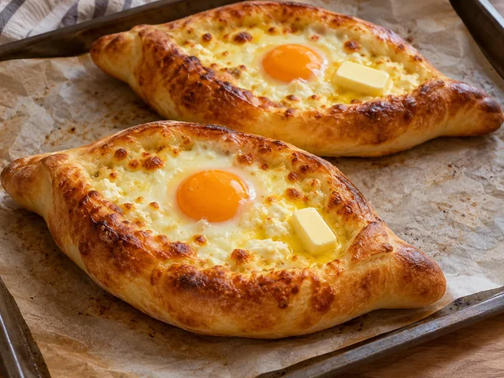

# 조지아식 아자리안 하차푸리

배 모양 빵 안에 모차렐라와 페타 치즈를 채워 굽고 달걀과 버터로 마무리하는 조지아식 치즈 빵입니다.

- 분량: 2인분
- 분류: 메인 요리, 간식/디저트

## 재료

- 중력분 — 250g
- 드라이이스트 — 4g
- 우유 — 100ml
- 미지근한 물 — 60ml
- 설탕 — 1작은술
- 소금 — 1/2작은술
- 올리브오일 — 1큰술
- 모차렐라 치즈 — 150g
- 페타 치즈 — 100g
- 달걀 — 2개
- 버터 — 20g

## 조리 방법

1. 우유 100ml와 미지근한 물 60ml를 약 35–38℃로 데운 뒤 드라이이스트 4g, 설탕 1작은술과 섞어 5분 둡니다. 중력분 250g, 소금 1/2작은술, 올리브오일 1큰술을 넣어 8–10분간 반죽합니다.

2. 반죽을 볼에 넣고 덮어 따뜻한 곳에서 약 50–60분, 부피가 거의 두 배가 될 때까지 발효합니다. 그동안 모차렐라 150g과 페타 100g을 잘게 찢거나 부숴 섞습니다.

3. 오븐을 220℃로 예열합니다. 반죽을 2등분해 각각 약 25×15cm 타원형으로 밀고 양쪽 긴 가장자리를 안으로 말아 양 끝을 꼬집어 배 모양으로 만듭니다. 치즈를 두 배 모양 반죽 안에 반씩 채웁니다.

4. 유산지를 깐 팬에 올려 220℃에서 13–17분 구워 가장자리가 황금색이고 치즈가 녹도록 합니다.

5. 각 빵 가운데 치즈를 살짝 밀어 작은 공간을 만들고 달걀 1개씩 깨 넣습니다. 오븐에서 3–5분 더 구워 흰자가 굳으면 꺼내 각 빵에 버터 10g씩 올립니다. 노른자는 촉촉할 수 있으며, 완숙이 필요하면 더 굽습니다.

The canonical data for this recipe is [recipe.json](recipe.json).
