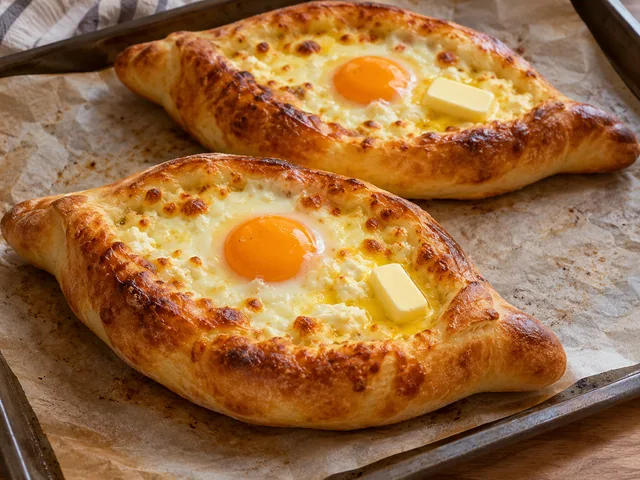

# Adjaruli Khachapuri (Georgian Cheese Bread)

A Georgian boat-shaped bread filled with mozzarella and feta, baked until bubbling and finished with egg and butter.

- Servings: 2
- Categories: Main Dish, Snack

## Ingredients

- All-purpose flour — 250g
- Dry yeast — 4g
- Milk — 100ml
- Lukewarm water — 60ml
- Sugar — 1 tsp
- Salt — 1/2 tsp
- Olive oil — 1 tbsp
- Mozzarella cheese — 150g
- Feta cheese — 100g
- Eggs — 2
- Butter — 20g

## Instructions

1. Warm 100ml milk and 60ml water to about 35–38°C, then stir in 4g dry yeast and 1 tsp sugar and let stand for 5 minutes. Add 250g all-purpose flour, 1/2 tsp salt, and 1 tbsp olive oil; knead for 8–10 minutes.

2. Cover the dough and let rise in a warm place for about 50–60 minutes, until nearly doubled. Meanwhile, shred 150g mozzarella and crumble 100g feta, then combine.

3. Preheat the oven to 220°C. Divide the dough in two, roll each into an oval about 25×15cm, roll the long edges inward, and pinch both ends to form boats. Divide the cheese mixture between the boats.

4. Transfer to a parchment-lined tray and bake at 220°C for 13–17 minutes, until the edges are golden and the cheese is melted.

5. Make a small well in the melted cheese in each bread and crack 1 egg into each. Return to the oven for 3–5 minutes until the whites are set. Add 10g butter to each. Yolks may remain runny; bake longer if fully cooked eggs are preferred.

The canonical data for this recipe is [recipe.json](recipe.json).
