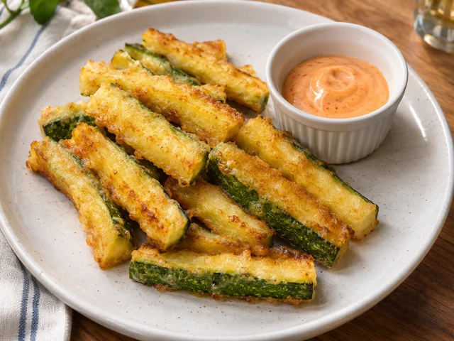
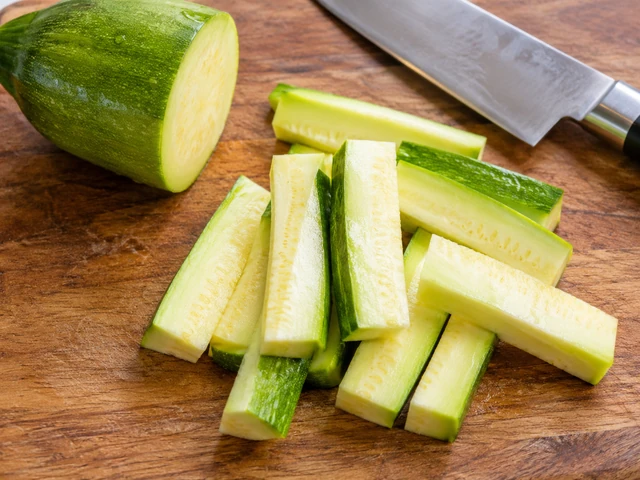
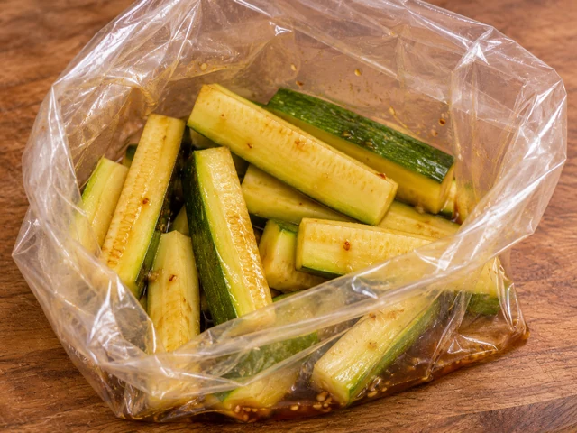
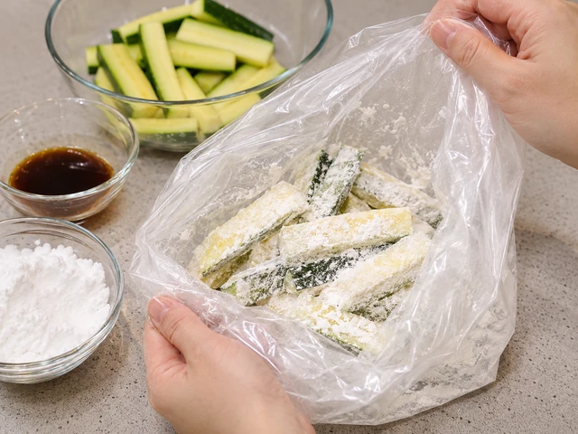
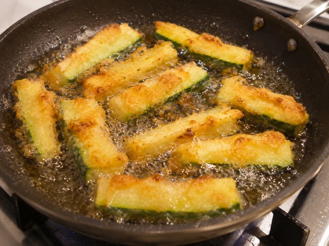
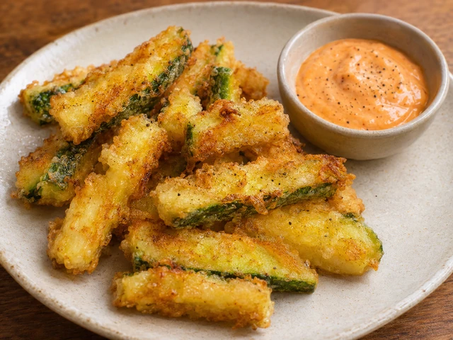

# 성시경 애호박튀김

성시경 레시피를 참고해 애호박 스틱에 간장과 치킨스톡으로 밑간하고 감자전분을 입혀 바삭하게 튀긴 요리입니다. 새콤매콤한 스리라차 마요 소스를 곁들입니다.

- 분량: 2인분
- 분류: 술안주, 간식/디저트, 한식

## 재료

- 애호박 — 1개 (약 300g)
- 양조간장 — 1큰술
- 액상 치킨스톡 (농축형) — 1/2큰술
- 감자전분 — 5큰술 (3큰술 + 2큰술)
- 후춧가루 — 1/4작은술 (밑간·소스 각 1/8작은술)
- 식용유 — 150ml
- 올리브유 — 50ml
- 마요네즈 — 3큰술
- 설탕 — 1/2큰술
- 레몬즙 — 1큰술
- 다진 마늘 — 1/2큰술
- 소금 — 1꼬집
- 스리라차 소스 — 1큰술

## 조리 단계

1. 애호박을 씻어 물기를 닦고 양 끝을 잘라냅니다. 길이 6–8cm, 굵기 약 1.5cm의 스틱으로 썹니다. 껍질은 벗기지 않습니다.

   

2. 식품용 비닐봉지에 애호박과 양조간장 1큰술, 액상 치킨스톡 1/2큰술을 넣고 가볍게 주물러 양념을 묻힙니다. 치킨스톡의 염도가 높은 경우 양을 줄입니다.

   

3. 후춧가루 1/8작은술과 감자전분 3큰술을 넣고 봉지에 공기를 남긴 채 입구를 닫아 흔듭니다. 남은 전분 2큰술을 넣어 다시 흔들고, 뭉친 가루는 털어냅니다. 오래 두지 말고 바로 튀깁니다.

   

4. 깊이 있는 프라이팬에 식용유 150ml와 올리브유 50ml를 넣고 중불에서 150–160°C로 데웁니다. 팬 높이의 절반 이상 기름을 채우지 않습니다. 애호박을 서로 닿지 않게 하나씩 넣고 4–6분간 집게로 굴려가며 튀깁니다. 필요하면 170°C까지 올려 표면이 노릇하고 바삭해지면 건져 철망에서 1–2분 기름을 뺍니다. 팬이 작으면 나누어 튀깁니다.

   

5. 작은 볼에 마요네즈 3큰술, 설탕 1/2큰술, 레몬즙 1큰술, 다진 마늘 1/2큰술, 소금 1꼬집, 후춧가루 1/8작은술, 스리라차 1큰술을 섞습니다. 튀김을 접시에 담고 소스는 따로 곁들여 바로 냅니다.

   

The canonical data for this recipe is [recipe.json](recipe.json).
