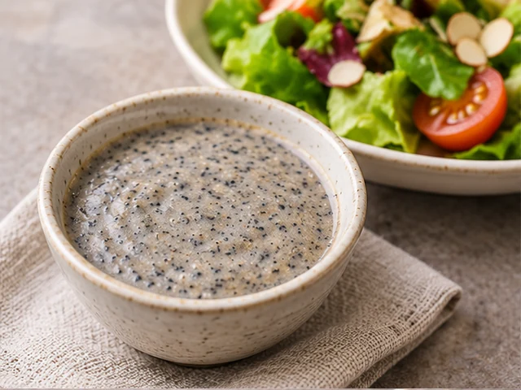
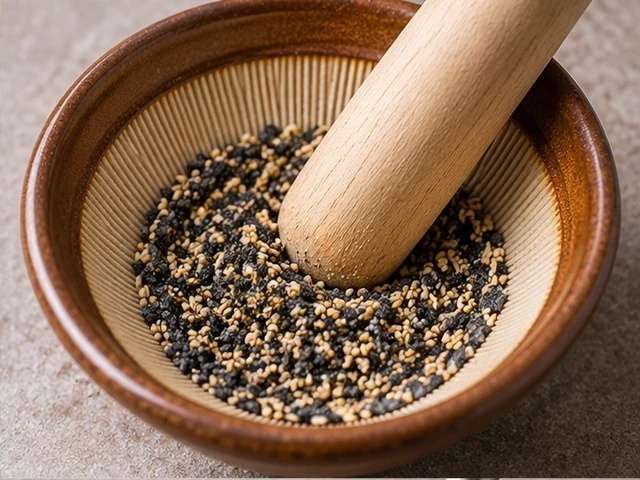
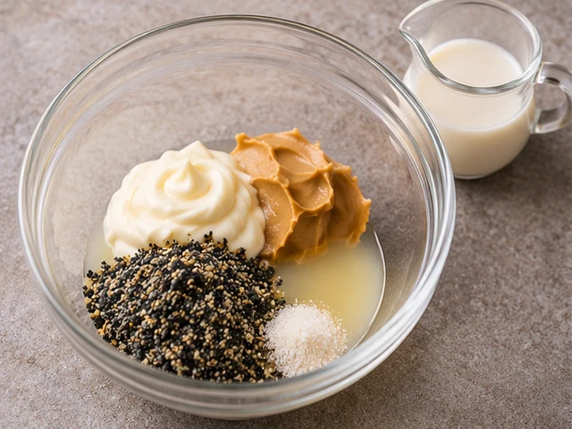
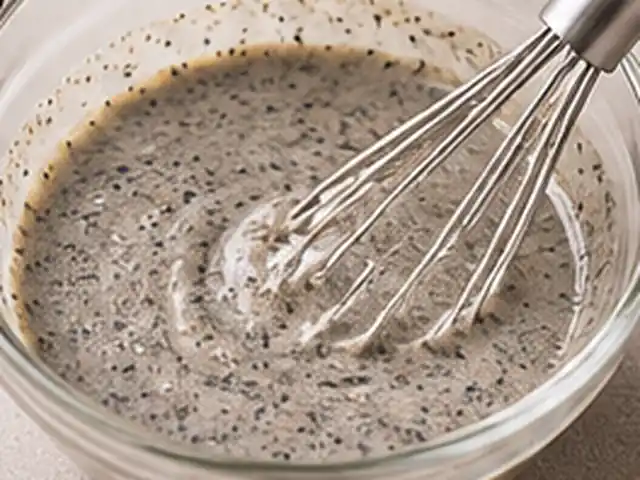

# 흑임자 샐러드 드레싱

볶은 흑임자와 참깨에 땅콩버터를 더하고 두유로 부드럽게 풀어 만든 고소하고 산뜻한 샐러드 드레싱입니다.

- 분량: 2인분
- 분류: 소스/드레싱

## 재료

- 볶은 흑임자 — 3큰술
- 볶은 참깨 — 1큰술
- 마요네즈 — 2큰술
- 무가당 땅콩버터 — 1/2큰술
- 레몬즙 — 1큰술
- 설탕 — 2작은술
- 소금 — 한 꼬집
- 무가당 두유 — 40~60ml

## 조리 방법

1. 볶은 흑임자 3큰술과 볶은 참깨 1큰술을 절구나 작은 믹서에 넣고 곱게 갑니다. 깨를 갈면 고소한 향이 더 잘 납니다.

   

2. 볼에 간 깨, 마요네즈 2큰술, 무가당 땅콩버터 1/2큰술, 레몬즙 1큰술, 설탕 2작은술, 소금 한 꼬집을 넣고 골고루 섞습니다.

   

3. 무가당 두유를 먼저 40ml 붓고 거품기로 부드럽게 섞습니다. 더 묽은 드레싱을 원하면 두유를 조금씩 추가해 최대 60ml까지 농도를 조절합니다. 완성한 드레싱을 샐러드에 곁들입니다.

   

## 참고

- [만개의레시피 — 흑임자드레싱 샐러드소스](https://www.10000recipe.com/recipe/6606174)의 깨·땅콩버터·두유 조합을 참고하여 2인분 기준으로 재구성했습니다.

---

The canonical data for this recipe is [recipe.json](recipe.json).