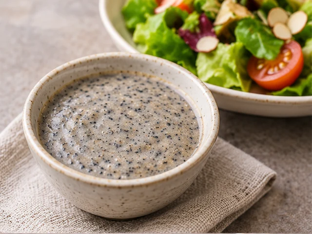
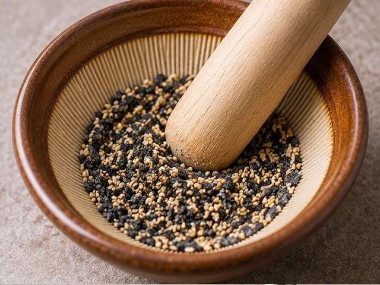
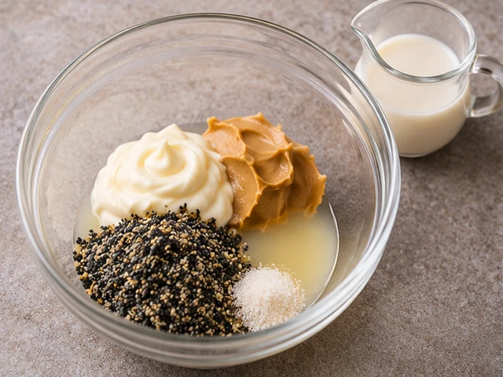
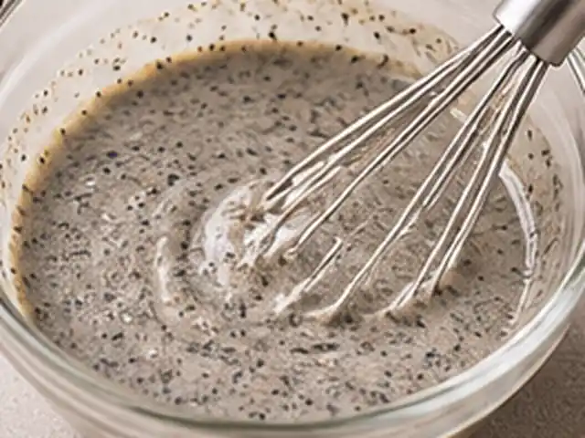

# Black Sesame Salad Dressing

A creamy, nutty salad dressing made with ground toasted black sesame seeds, mayonnaise, vinegar, and honey.

- Servings: 2
- Categories: Sauce/Dressing

## Ingredients

- Toasted black sesame seeds — 2 tbsp (about 20 g)
- Mayonnaise — 3 tbsp
- Vinegar — 1 tbsp
- Honey — 2 tsp
- Soy sauce — 1 tsp
- Water — 1–2 tbsp
- Salt (optional) — a pinch

## Instructions

1. Grind 2 tbsp toasted black sesame seeds in a mortar or blender until fine. A little texture is fine.

   

2. In a bowl, combine 3 tbsp mayonnaise, 1 tbsp vinegar, 2 tsp honey, 1 tsp soy sauce, and the ground sesame seeds. Add a pinch of salt if desired.

   

3. Whisk until evenly mixed, then add 1 tbsp water. If too thick, add up to 1 tbsp more water to reach your preferred consistency. Use the finished dressing immediately.

   

---

The canonical data for this recipe is [recipe.json](recipe.json).