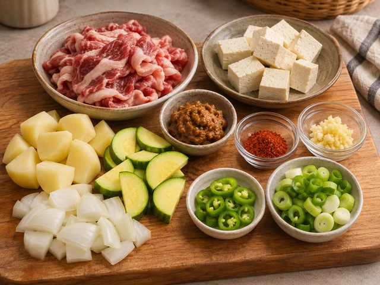
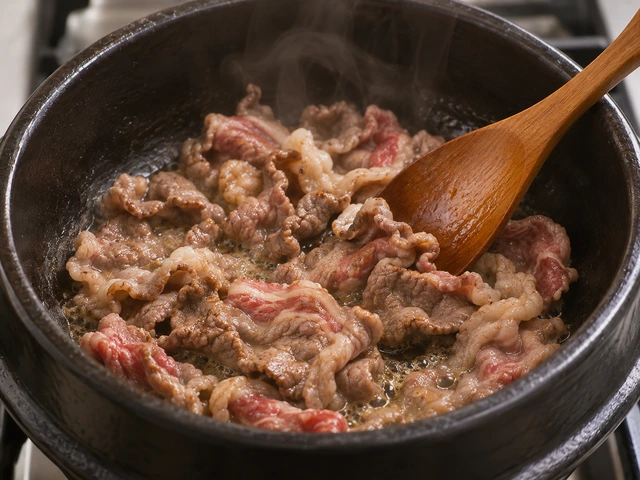
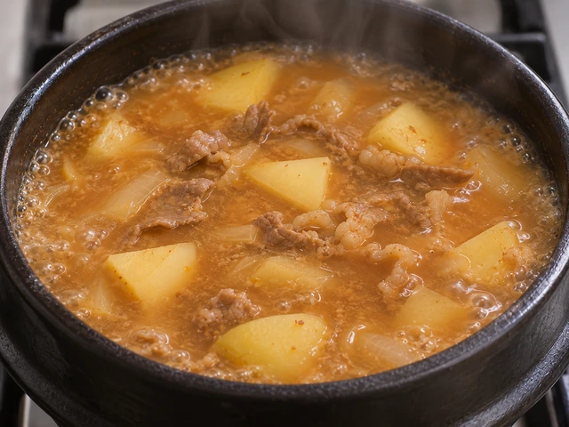

# 차돌박이 된장찌개

차돌박이에서 나온 고소한 기름과 구수한 된장으로 맛을 낸 찌개입니다. 별도의 육수나 식용유 없이 두부, 감자, 애호박을 넣어 약 25분 만에 완성합니다.

- 분량: 2인분
- 분류: 국/찌개, 한식

## 재료

- 차돌박이 — 150g
- 감자 — 100g
- 애호박 — 100g
- 양파 — 80g
- 두부 — 150g
- 대파 — 30g
- 청양고추 — 1개
- 된장 — 2큰술
- 고춧가루 — 1작은술
- 다진 마늘 — 1작은술
- 물 — 500ml

## 조리 방법

1. 감자는 껍질을 벗겨 1.5cm 크기로, 애호박과 양파는 한입 크기로, 두부는 2cm 크기로 썹니다. 대파와 청양고추는 송송 썰고 차돌박이는 먹기 좋은 크기로 준비합니다.

   

2. 냄비를 중불로 달군 뒤 기름을 따로 두르지 않고 차돌박이를 넣어 2–3분 볶습니다. 고기 겉면이 익고 기름이 나오면 기름이 지나치게 많을 경우 일부를 걷어냅니다.

   

3. 물 500ml를 붓고 된장 2큰술을 풀어 넣습니다. 감자와 양파를 넣고 센불로 끓인 뒤 중불로 줄여 7–8분, 감자가 반쯤 익을 때까지 끓입니다.

   

4. 애호박, 두부와 고춧가루 1작은술을 넣고 중불에서 5–6분 끓입니다. 감자가 젓가락으로 쉽게 찔리는지 확인합니다.

   

5. 대파, 청양고추, 다진 마늘 1작은술을 넣고 2분 더 끓입니다. 간을 보고 너무 짜면 물을 조금 추가한 뒤 한소끔 끓여 완성합니다.

   

The canonical data for this recipe is [recipe.json](recipe.json).
