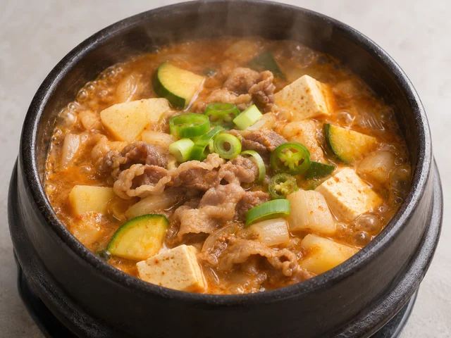
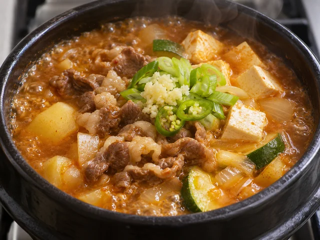

# Beef Brisket Doenjang Jjigae

A hearty Korean soybean paste stew with thinly sliced beef brisket, tofu, potatoes and zucchini. Rendered beef fat gives the broth a rich flavor without extra oil or stock.

- Servings: 2
- Tags: Soup/Stew, Korean

## Ingredients

- Thinly sliced beef brisket — 150 g
- Potato — 100 g
- Korean zucchini (or regular zucchini) — 100 g
- Onion — 80 g
- Medium-firm tofu — 150 g
- Green onion — 30 g
- Korean hot green chili — 1
- Doenjang (Korean fermented soybean paste) — 2 tbsp
- Gochugaru (Korean red pepper flakes) — 1 tsp
- Minced garlic — 1 tsp
- Water — 500 ml

## Instructions

1. Peel the potato and cut it into 1.5 cm cubes. Cut the zucchini and onion into bite-sized pieces and the tofu into 2 cm cubes. Slice the green onion and chili into rings, and cut the brisket into bite-sized pieces.

2. Heat a pot over medium heat. Add the brisket without extra oil and stir-fry for 2–3 minutes until the outside is cooked and the fat renders. Skim off some fat if there is too much.

3. Pour in 500 ml water and dissolve 2 tbsp doenjang in it. Add the potato, bring to a boil over high heat, then reduce to medium and simmer for 7–8 minutes until the potato is partly tender.

4. Add the zucchini, onion, tofu and 1 tsp gochugaru. Simmer over medium heat for 5–6 minutes and check that a chopstick easily pierces the potato.

5. Add the green onion, chili and 1 tsp minced garlic. Simmer for another 2 minutes. Taste and, if too salty, add a little water and bring back to a boil before serving.

   

The canonical data for this recipe is [recipe.json](recipe.json).
