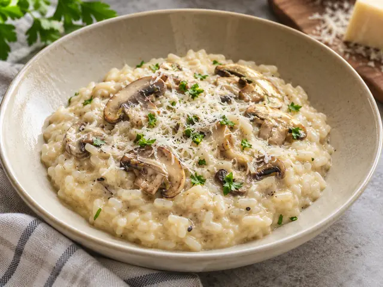
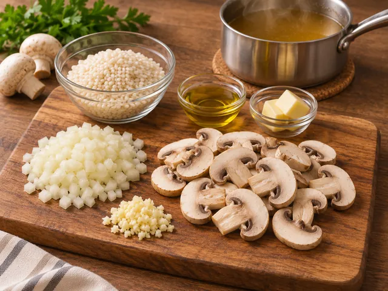
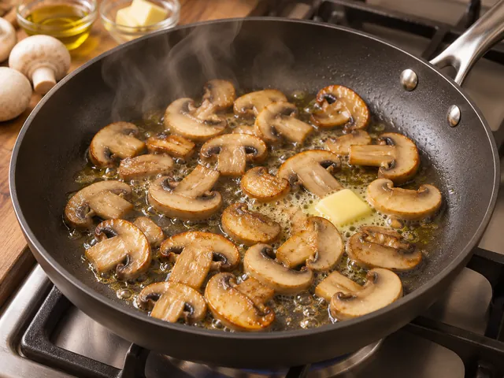
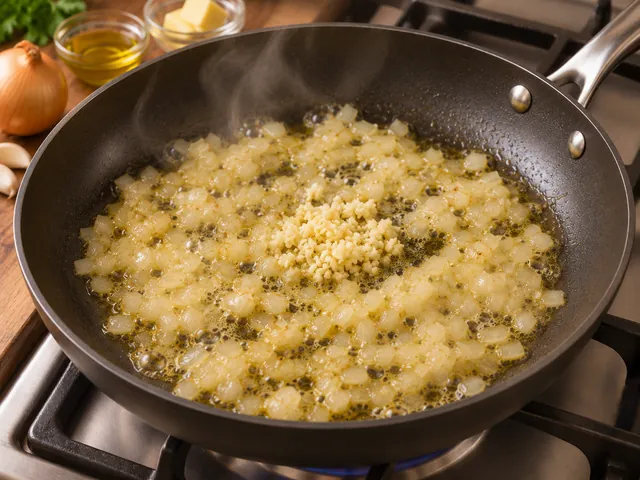
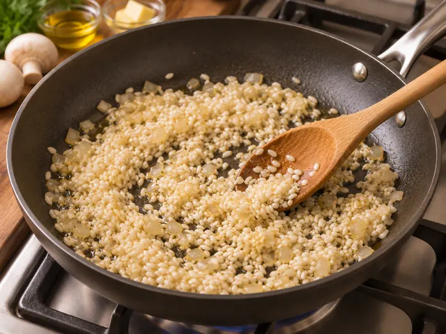
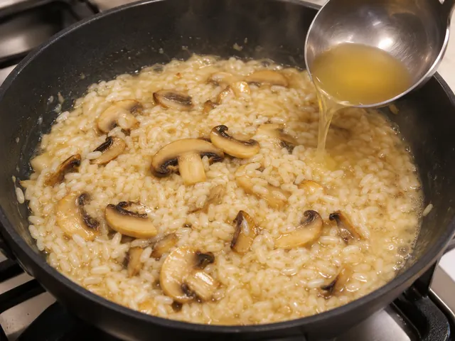
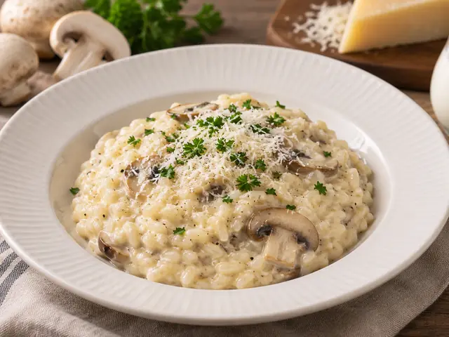

# 크림 리조또

노릇하게 볶은 양송이버섯을 쌀과 육수로 익히고 생크림을 더한 뒤, 불을 끄고 차가운 버터와 파르메산 치즈로 만테까레해 윤기 있게 완성하는 리조또입니다.

- 분량: 2인분
- 분류: 메인 요리, 한그릇요리

## 재료

- 리조또용 쌀(아르보리오) — 180g
- 양송이버섯 — 150g
- 양파 — 80g
- 마늘 — 10g
- 올리브오일 — 15ml
- 버터 — 30g
- 육수(채소 또는 닭) — 650ml
- 생크림 — 100ml
- 파르메산 치즈 — 40g
- 소금 — 1g
- 검은후추 — 1g
- 파슬리 — 2g

## 조리 방법

1. 양파 80g과 마늘 10g을 잘게 다지고 양송이버섯 150g을 3–4mm 두께로 썹니다. 육수 650ml는 작은 냄비에 데워 약불로 따뜻하게 유지합니다.

   

2. 넓은 팬에 올리브오일 15ml와 버터 10g을 중강불로 데우고 양송이버섯을 4–5분 노릇하게 볶아 접시에 덜어 둡니다.

   

3. 버섯을 덜어 낸 같은 팬에 남은 기름으로 양파 80g을 중약불에서 3분 볶습니다. 다진 마늘 10g을 넣고 30초 더 볶아 향을 냅니다.

   

4. 씻지 않은 아르보리오 쌀 180g을 넣고 중불에서 1–2분 저으며 볶아 쌀알 가장자리가 반투명해지게 합니다.

   

5. 따뜻한 육수 650ml를 약 100ml씩 나눠 붓고 거의 흡수되면 다음 육수를 더하며 쌀을 16–20분 익힙니다. 14분부터 쌀알을 맛보고, 마지막 3분에 볶은 버섯을 다시 넣습니다. 중심에 약간 씹는 맛이 남으면 생크림 100ml를 넣고 약불에서 1분 섞어 데웁니다.

   

6. 불을 끈 뒤 30초 정도 식혀 차가운 버터 20g과 곱게 간 파르메산 치즈 40g을 넣습니다. 팬을 앞뒤로 흔들거나 주걱으로 빠르게 30–60초 섞어 윤기 있게 유화시키는 만테까레를 합니다. 소금 1g과 검은후추 1g으로 간하고 접시에 담아 다진 파슬리 2g을 뿌려 바로 냅니다.

   

The canonical data for this recipe is [recipe.json](recipe.json).
