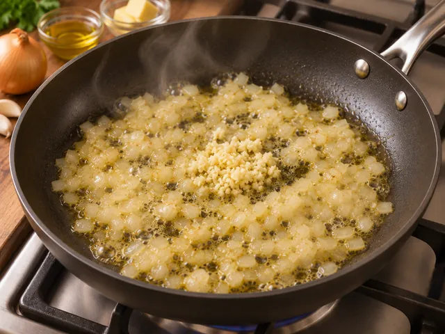
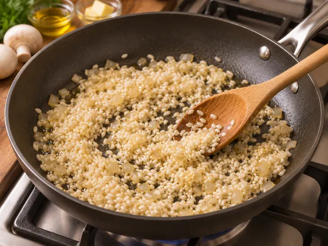
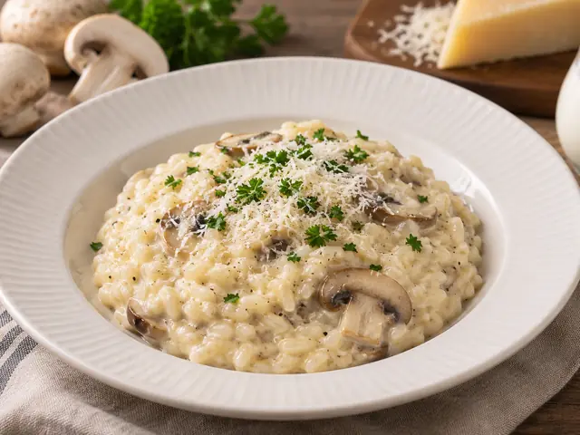

# Creamy Mushroom Risotto

A rich, creamy risotto made by browning button mushrooms, gradually cooking Arborio rice in warm stock, and finishing with cream and Parmesan cheese.

- Servings: 2
- Categories: 메인 요리, 한그릇요리

## Ingredients

- Arborio rice (short-grain risotto rice) — 180g
- Button mushrooms — 150g
- Onion — 80g
- Garlic — 10g
- Olive oil — 15ml
- Butter — 20g
- Vegetable or chicken stock — 650ml
- Heavy cream — 100ml
- Parmesan cheese — 40g
- Salt — 1g
- Black pepper — 1g
- Parsley — 2g

## Instructions

1. Finely dice 80g onion and 10g garlic, and slice 150g button mushrooms 3–4mm thick. Warm 650ml stock in a small saucepan and keep it hot over low heat.

   

2. Heat 15ml olive oil and 10g butter in a wide pan over medium-high heat. Sauté the mushrooms for 4–5 minutes until golden, then transfer to a plate.

   

3. Add the remaining 10g butter and the onion to the same pan. Cook over medium-low heat for 3 minutes, then add the garlic and cook for 30 seconds more until fragrant.

   

4. Add 180g unwashed Arborio rice and stir over medium heat for 1–2 minutes until the edges of the grains begin to look translucent.

   

5. Add the 650ml warm stock in roughly 100ml increments, stirring and waiting until each addition is nearly absorbed. Continue for 18–20 minutes. Return the mushrooms during the final 3 minutes and cook until the rice retains a slight bite at its center.

   

6. Turn off the heat and stir in 100ml heavy cream and 40g Parmesan. Season with 1g salt and 1g black pepper. Spoon into bowls, sprinkle with 2g chopped parsley, and serve immediately.

   

The canonical data for this recipe is [recipe.json](recipe.json).
