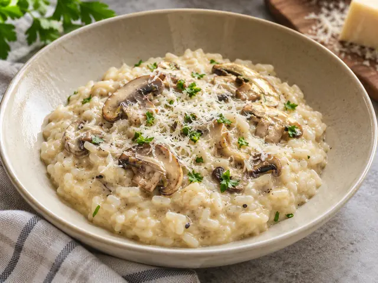
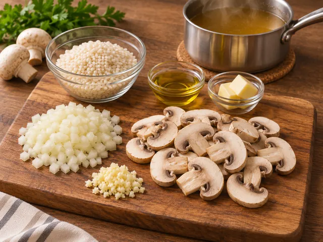
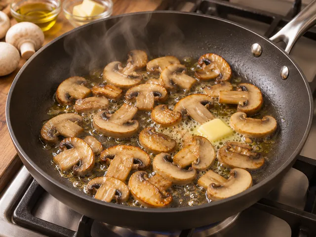
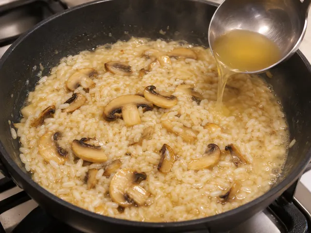

# Creamy Mushroom Risotto

Creamy mushroom risotto with golden sautéed mushrooms and Arborio rice simmered in warm stock, finished with cream and an off-heat mantecatura of cold butter and Parmesan.

- Servings: 2
- Categories: 메인 요리, 한그릇요리

## Ingredients

- Arborio rice (short-grain risotto rice) — 180g
- Button mushrooms — 150g
- Onion — 80g
- Garlic — 10g
- Olive oil — 15ml
- Butter — 30g
- Vegetable or chicken stock — 650ml
- Heavy cream — 100ml
- Parmesan cheese — 40g
- Salt — 1g
- Black pepper — 1g
- Parsley — 2g

## Instructions

1. Finely dice 80g onion and 10g garlic, and slice 150g button mushrooms 3–4mm thick. Warm 650ml stock in a small saucepan and keep it hot over low heat.

   

2. Heat 15ml olive oil and 10g butter in a wide pan over medium-high heat. Sauté the mushrooms for 4–5 minutes until golden, then transfer to a plate.

   

3. Use the oil left in the pan after removing the mushrooms to cook 80g onion over medium-low heat for 3 minutes. Add 10g chopped garlic and sauté for another 30 seconds until fragrant.

   

4. Add 180g unwashed Arborio rice and stir over medium heat for 1–2 minutes until the edges of the grains begin to look translucent.

   

5. Add 650ml warm stock in roughly 100ml increments, adding more when nearly absorbed, and simmer the rice for 16–20 minutes. Start tasting at 14 minutes and return the mushrooms for the final 3 minutes. When the grains retain a slight bite, add 100ml heavy cream and warm gently for 1 minute while stirring.

   

6. Turn off the heat and let the pan cool for about 30 seconds. Add 20g cold butter and 40g finely grated Parmesan. Shake the pan or stir vigorously for 30–60 seconds to emulsify the sauce (mantecatura) until glossy. Season with 1g salt and 1g black pepper. Plate, garnish with 2g chopped parsley, and serve at once.

   

The canonical data for this recipe is [recipe.json](recipe.json).
