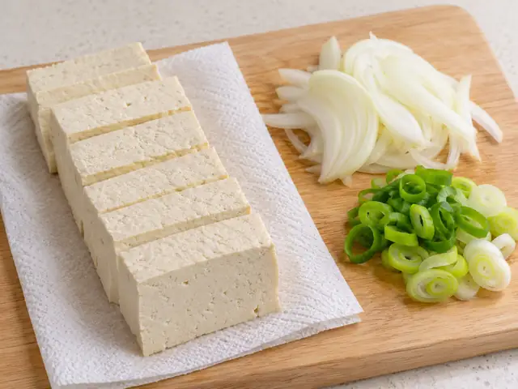

# 두부조림

노릇하게 구운 두부를 간장과 고춧가루 양념에 자작하게 졸여 만드는 매콤짭조름한 한국식 반찬입니다.

- 분량: 2인분
- 분류: 반찬, 한식

## 재료

- 단단한 두부 — 400g
- 양파 — 1/2개 (약 100g)
- 대파 — 1/2대 (약 30g)
- 식용유 — 2큰술
- 물 — 120ml
- 진간장 — 2큰술
- 고춧가루 — 1큰술
- 다진 마늘 — 1작은술
- 설탕 — 1작은술
- 참기름 — 1작은술
- 통깨 (선택) — 1작은술

## 조리 방법

1. 두부 400g을 약 1.5cm 두께로 썰어 키친타월로 물기를 눌러 제거합니다. 양파 1/2개는 얇게 채 썰고 대파 1/2대는 송송 썹니다.

   

2. 작은 그릇에 물 120ml, 진간장 2큰술, 고춧가루 1큰술, 다진 마늘 1작은술, 설탕 1작은술을 넣어 골고루 섞습니다.

3. 넓은 팬을 중불로 달구고 식용유 2큰술을 두릅니다. 두부를 서로 겹치지 않게 올려 각 면을 2–3분씩 노릇하게 굽습니다.

4. 두부 사이에 양파를 넣고 양념물을 골고루 붓습니다. 중약불로 줄여 뚜껑을 살짝 덮고 5분간 졸이며, 팬을 가볍게 흔들어 양념이 바닥에 눌어붙지 않게 합니다.

5. 대파를 넣고 2–3분 더 졸여 양념이 자작하게 남으면 불을 끕니다. 참기름 1작은술을 둘러 마무리하고, 원하면 통깨 1작은술을 뿌립니다.

The canonical data for this recipe is [recipe.json](recipe.json).
