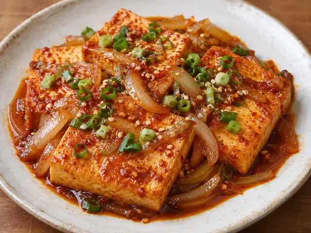
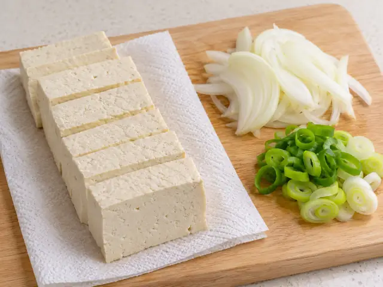

# Dubu Jorim (Korean Braised Tofu)

Golden pan-fried tofu gently braised in a savory, mildly spicy Korean soy-chili sauce with onion and scallion.

- Servings: 2
- Categories: Side Dish, Korean

## Ingredients

- Firm tofu — 400g
- Onion — 1/2 (about 100g)
- Scallion — 1/2 stalk (about 30g)
- Neutral cooking oil — 2 tbsp
- Water — 120ml
- Soy sauce — 2 tbsp
- Korean red pepper flakes (gochugaru) — 1 tbsp
- Minced garlic — 1 tsp
- Sugar — 1 tsp
- Toasted sesame oil — 1 tsp
- Toasted sesame seeds (optional) — 1 tsp

## Instructions

1. Slice 400g firm tofu into roughly 1.5cm-thick pieces and pat dry thoroughly. Thinly slice 1/2 onion and finely slice 1/2 scallion.

   

2. Mix 120ml water, 2 tbsp soy sauce, 1 tbsp gochugaru, 1 tsp minced garlic, and 1 tsp sugar in a small bowl.

3. Heat 2 tbsp neutral oil in a wide skillet over medium heat. Add tofu in one layer and pan-fry for 2–3 minutes per side until golden.

4. Add the onion around the tofu and pour the seasoning liquid over it. Reduce to medium-low, cover loosely, and simmer for 5 minutes, gently shaking the skillet to prevent sticking.

5. Add the scallion and simmer for another 2–3 minutes until a little sauce remains. Turn off the heat, drizzle with 1 tsp toasted sesame oil, and optionally sprinkle with 1 tsp sesame seeds.

The canonical data for this recipe is [recipe.json](recipe.json).
