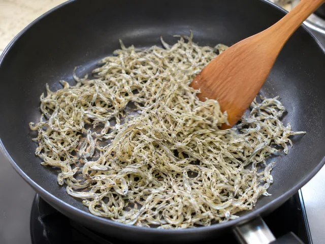

# 고추장 멸치볶음

중멸치에 매콤달콤한 고추장 양념을 입히고 청양고추와 참기름으로 향을 더한 한식 밑반찬입니다.

- 분량: 2인분
- 분류: 반찬, 한식

## 재료

- 중멸치 — 1컵
- 청양고추 — 1개
- 식용유 — 3큰술
- 물엿 — 2큰술
- 황설탕 — 1/2큰술
- 고추장 — 1큰술
- 고운 고춧가루 — 1/2큰술
- 참기름 — 1큰술
- 통깨 — 1작은술

## 조리 단계

1. 볼에 고추장 1큰술, 고운 고춧가루 1/2큰술, 물엿 2큰술, 황설탕 1/2큰술을 넣어 섞습니다. 청양고추 1개는 길이로 반을 가르고 3mm 두께로 썹니다.

   

2. 중멸치 1컵을 준비합니다. 국물용 큰 멸치라면 머리와 내장, 굵은 가시를 제거합니다. 팬에 식용유 3큰술을 두르고 중불에서 멸치를 볶아 비린 향을 줄이고 바삭하게 만듭니다.

   

3. 멸치를 팬의 한쪽으로 모으고 약불로 낮춥니다. 빈 공간에 양념을 부어 저으면서 설탕을 녹이고 작은 기포가 전체에 올라올 때까지 끓입니다.

   

4. 멸치를 양념에 넣어 고루 버무린 다음 썰어 둔 청양고추를 넣고 짧게 볶습니다. 양념이 타지 않도록 계속 저어 줍니다.

   

5. 불을 끄고 참기름 1큰술과 통깨 1작은술을 넣어 섞습니다. 접시에 담아 식혀 먹습니다.

   

The canonical data for this recipe is [recipe.json](recipe.json).
