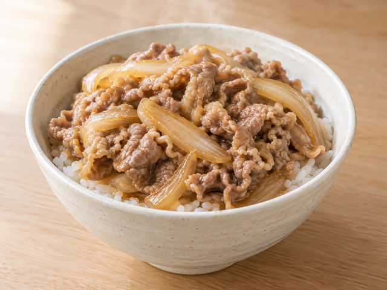
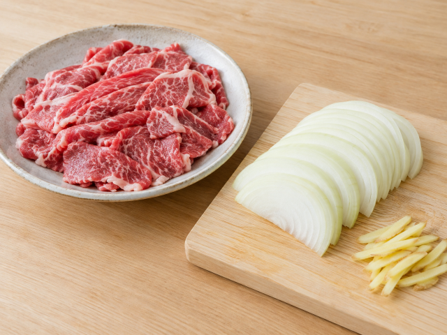
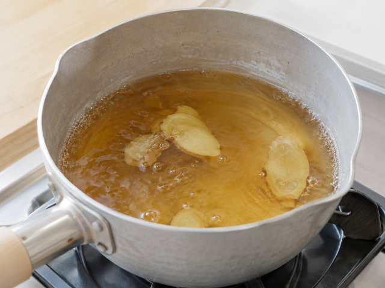
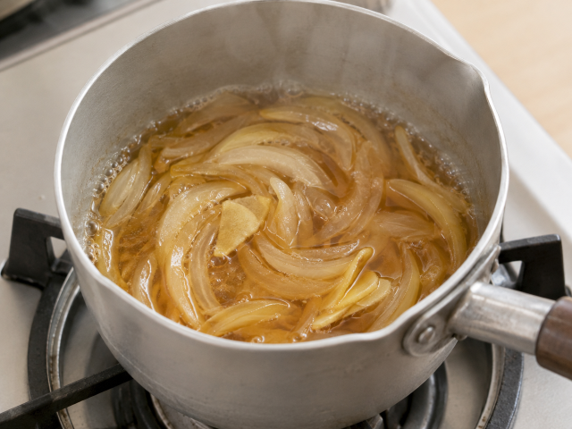
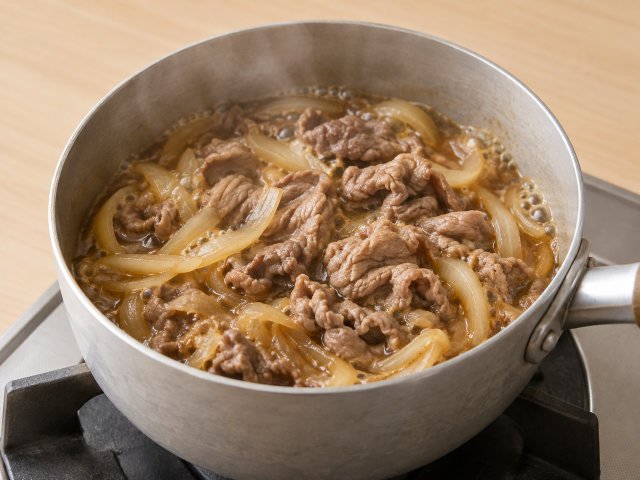
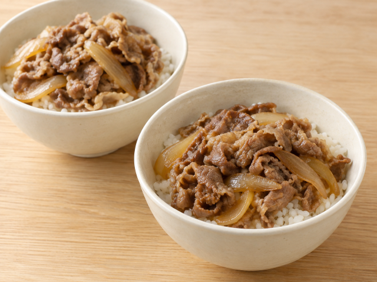

# 규동 (일본식 소고기 덮밥)

얇게 썬 소고기와 양파를 달콤짭조름한 다시 간장 국물에 익혀 밥 위에 올리는 일본 가정식.

- 분량: 2인분
- 분류: 일본, 덮밥

## 재료

- 얇게 썬 소고기 — 250g
- 양파 — 1개 (약 150g)
- 따뜻한 밥 — 2공기 (약 360g)
- 물 — 150ml
- 간장 — 2큰술
- 미림 — 2큰술
- 설탕 — 2작은술
- 가쓰오 다시 가루 — 1/2작은술
- 생강 — 10g

## 조리 방법

1. 양파는 5mm 두께로 채 썰고 생강 10g은 얇게 썹니다. 소고기는 뭉친 부분을 풀어 둡니다.

   

2. 작은 냄비에 물 150ml, 간장 2큰술, 미림 2큰술, 설탕 2작은술, 다시 가루 1/2작은술과 생강을 넣어 끓입니다.

   

3. 양파를 넣어 중불에서 5분 익혀 투명하게 만듭니다.

   

4. 소고기 250g을 한 장씩 펼쳐 넣고 4–6분 끓여 완전히 익힙니다. 표면에 뜨는 거품은 걷어내고 국물이 너무 줄면 물을 조금 보충합니다.

   

5. 따뜻한 밥을 두 그릇에 담고 고기와 양파를 나누어 얹습니다. 남은 국물을 취향에 맞게 끼얹습니다.

   

The canonical data for this recipe is [recipe.json](recipe.json).
