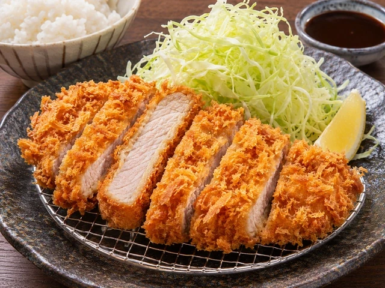
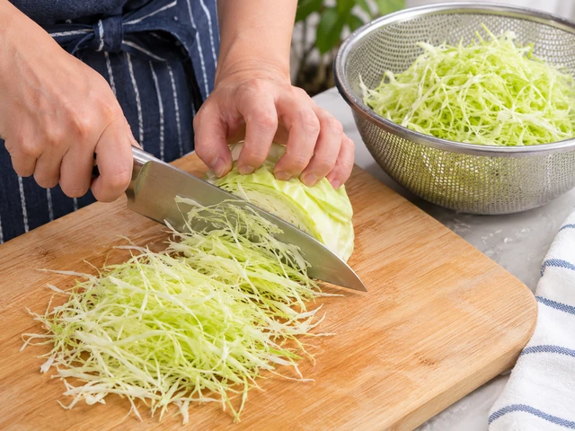
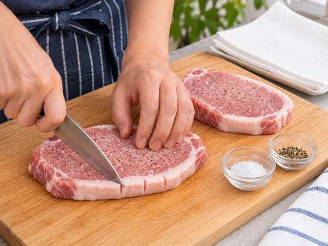
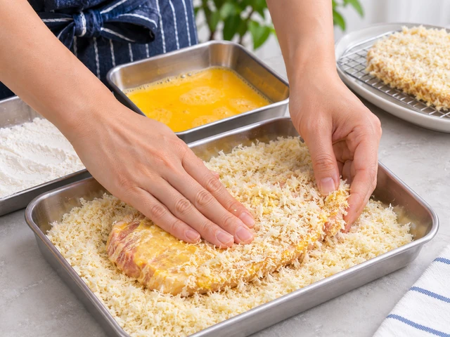
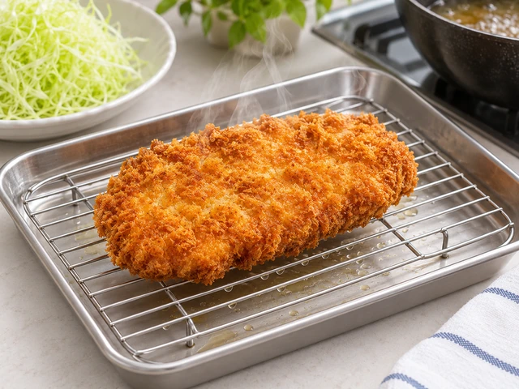

# 일식 돈까스 (돈카츠)

두툼한 돼지고기 등심에 일본식 빵가루를 입혀 황금빛으로 튀긴 돈카츠입니다. 곱게 채 썬 양배추와 돈카츠 소스, 밥을 곁들입니다.

- 분량: 2인분
- 분류: 메인 요리, 일식

## 재료

- 돼지고기 등심 (돈카츠용) — 2장 (각 150g, 두께 약 1.5cm)
- 소금 — 1/3작은술
- 후춧가루 — 약간
- 밀가루 — 3큰술
- 달걀 — 1개
- 일본식 빵가루 (판코) — 100g
- 식용유 (튀김용) — 약 600ml
- 양배추 — 150g
- 찬물 — 양배추를 헹굴 만큼
- 돈카츠 소스 — 4큰술
- 밥 — 2공기
- 레몬 (선택) — 1/2개

## 조리 방법

1. 양배추 150g을 가늘게 채 썰어 찬물에 헹군 뒤 체에 밭쳐 물기를 충분히 뺍니다.

   

2. 돼지고기 등심 2장의 지방과 살코기 경계에 2~3곳 칼집을 내어 튀길 때 휘지 않게 합니다. 두께를 약 1.5cm로 고르게 다듬고 키친타월로 물기를 닦은 뒤 소금 1/3작은술과 후춧가루 약간을 앞뒤에 나누어 뿌립니다.

   

3. 넓은 접시 세 개에 밀가루 3큰술, 잘 풀어 놓은 달걀 1개, 일본식 빵가루(판코) 100g을 각각 준비합니다.

   

4. 등심에 밀가루를 얇게 묻히고 여분을 털어낸 다음 달걀물에 고루 적십니다. 마지막으로 빵가루를 앞뒤에 올려 손으로 가볍게 눌러 붙입니다.

   

5. 깊은 팬에 식용유 약 600ml를 붓고 170~175℃로 예열합니다. 돈카츠를 조심스럽게 넣어 한쪽 면을 3~4분 튀기고 뒤집어 3~4분 더 튀깁니다. 겉이 황금빛이고 돼지고기 중심 온도가 63℃ 이상이 되도록 익히며, 팬이 좁다면 한 장씩 튀깁니다.

   

6. 튀긴 돈카츠를 식힘망에 올려 기름을 빼고 약 3분간 휴지시킵니다. 종이타월에 오래 놓아두면 바닥의 튀김옷이 눅눅해질 수 있습니다.

   

7. 돈카츠를 약 2cm 폭으로 썰어 채 썬 양배추와 밥 2공기를 곁들여 담습니다. 돈카츠 소스 4큰술을 나누어 내고, 원한다면 레몬 1/2개를 쐐기 모양으로 잘라 곁들입니다.

   

---

The canonical data for this recipe is [recipe.json](recipe.json).
