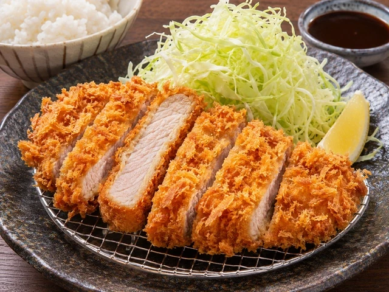
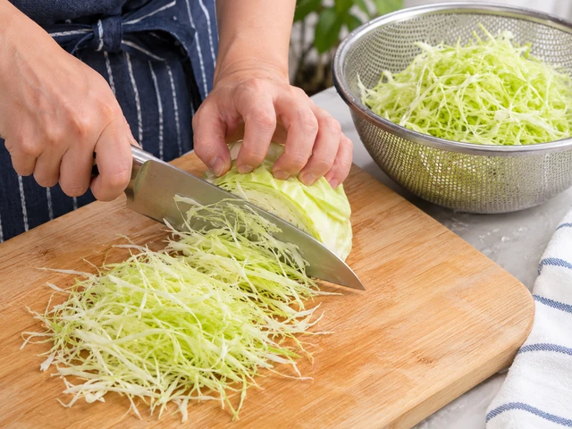
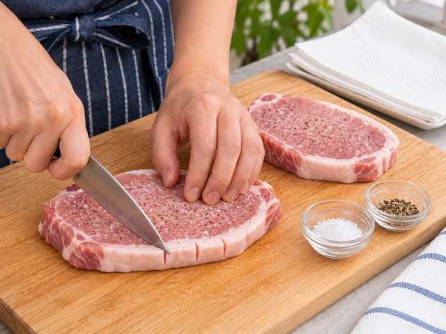
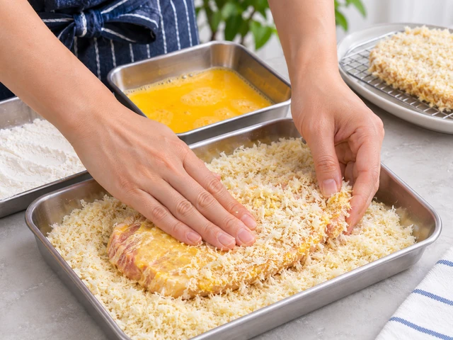
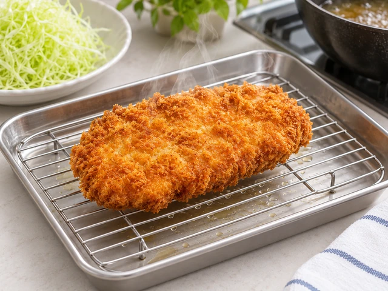
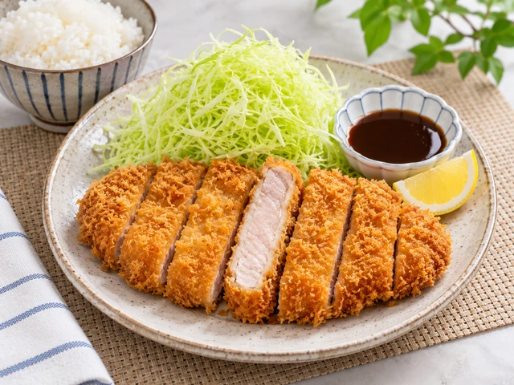

# Japanese Pork Tonkatsu

Thick pork loin cutlets coated in airy Japanese panko breadcrumbs and fried until golden and crisp, served with shredded cabbage, tonkatsu sauce, and rice.

- Servings: 2
- Categories: Main Dish, Japanese

## Ingredients

- Pork loin cutlets — 2 pieces (150g each, about 1.5cm thick)
- Salt — 1/3 tsp
- Ground black pepper — A pinch
- All-purpose flour — 3 tbsp
- Egg — 1
- Japanese panko breadcrumbs — 100g
- Neutral frying oil — About 600ml
- Cabbage — 150g
- Cold water — Enough to rinse the cabbage
- Tonkatsu sauce — 4 tbsp
- Cooked rice — 2 bowls
- Lemon (optional) — 1/2

## Instructions

1. Shred 150g cabbage into very fine strips. Rinse in cold water and drain thoroughly in a colander.

   

2. Make 2–3 small cuts along the fat-to-meat edge of each pork loin cutlet to prevent curling. Even out the thickness to about 1.5cm, pat dry with paper towels, and season both sides with a total of 1/3 tsp salt and a pinch of black pepper.

   

3. Set out three shallow dishes with 3 tbsp flour, 1 beaten egg, and 100g Japanese panko breadcrumbs, respectively.

   

4. Coat each pork cutlet lightly with flour and shake off the excess. Dip into beaten egg, then press gently into the panko on both sides so the crumbs adhere.

   

5. Pour about 600ml neutral oil into a deep skillet and heat to 170–175°C (340–350°F). Carefully add the cutlets and fry for 3–4 minutes on one side, then turn and fry for another 3–4 minutes. Cook until golden and the center of the pork reaches at least 63°C (145°F); fry one at a time if the pan is small.

   

6. Transfer the cooked cutlets to a wire rack to drain and rest for about 3 minutes. Leaving them on paper towels for too long may make the underside soggy.

   

7. Slice the tonkatsu into strips about 2cm wide. Serve with the shredded cabbage and 2 bowls of cooked rice. Divide 4 tbsp tonkatsu sauce between servings, and add wedges cut from 1/2 lemon if desired.

   

---

The canonical data for this recipe is [recipe.json](recipe.json).
