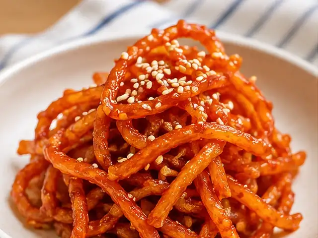

# 진미채볶음

부드럽게 버무린 진미채에 달콤매콤한 고추장 양념을 입힌 밥반찬입니다.

- 분량: 2인분
- 분류: 반찬, 한식

## 재료

- 진미채 — 120g
- 마요네즈 — 1큰술
- 고추장 — 1큰술
- 올리고당 — 1큰술
- 진간장 — 1작은술
- 다진 마늘 — 1/2작은술
- 식용유 — 1작은술
- 물 — 2큰술
- 참기름 — 1작은술
- 통깨 — 1작은술

## 조리 방법

1. 진미채 120g은 가위로 5~6cm 길이로 자르고 뭉친 부분을 풀어 줍니다.
2. 볼에 진미채와 마요네즈 1큰술을 넣고 고루 버무려 5분간 둡니다.
3. 작은 그릇에 고추장 1큰술, 올리고당 1큰술, 진간장 1작은술, 다진 마늘 1/2작은술, 물 2큰술을 섞어 양념을 만듭니다.
4. 팬에 식용유 1작은술을 두르고 약불로 달군 뒤 양념을 넣어 30초~1분 정도 저으며 살짝 끓입니다.
5. 불을 끄고 마요네즈에 버무린 진미채를 넣어 양념이 골고루 묻도록 섞습니다. 양념이 잘 섞이지 않으면 아주 약한 불에서 20~30초만 더 볶습니다.
6. 참기름 1작은술을 넣어 섞고 통깨 1작은술을 뿌려 마무리합니다.

---

The canonical data for this recipe is [recipe.json](recipe.json).
