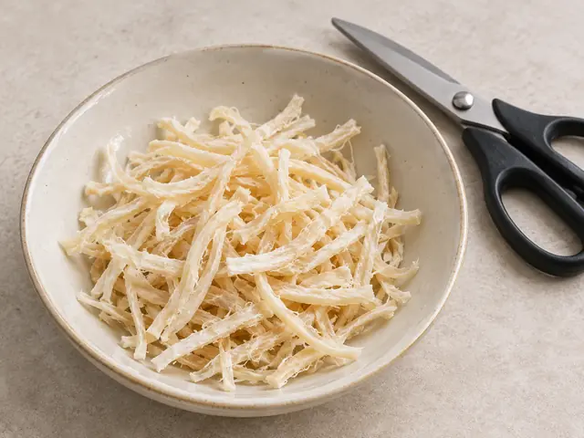
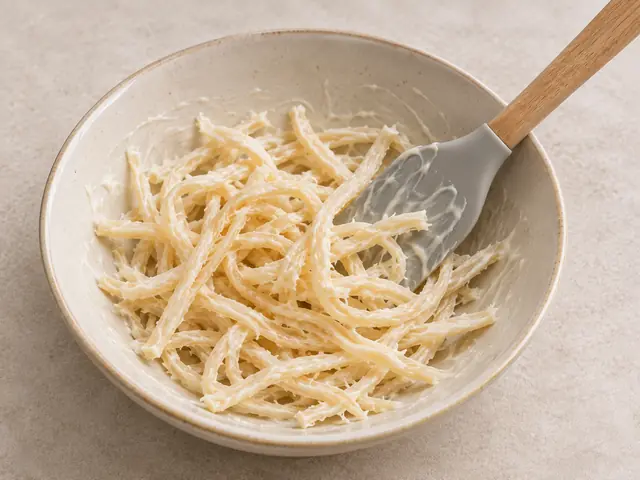
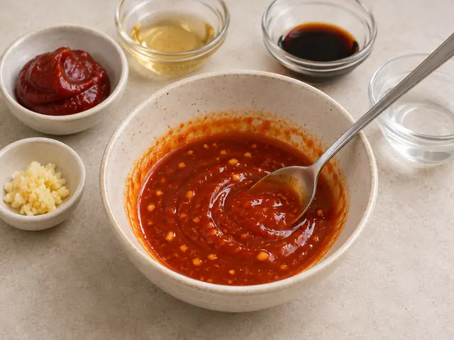
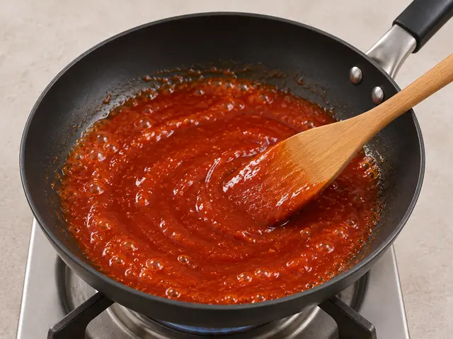
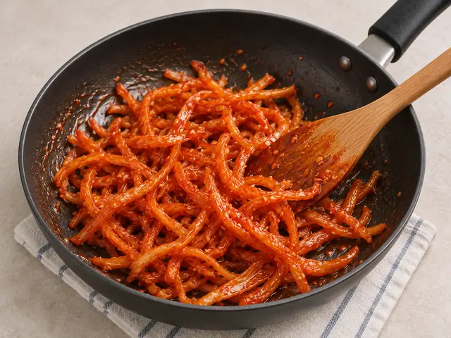
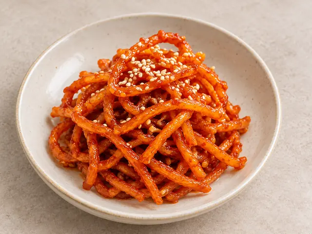

# Spicy Stir-Fried Dried Squid (Jinmichae Bokkeum)

Tender dried squid strips coated in a sweet and spicy gochujang sauce, a classic Korean rice side dish.

- Servings: 2
- Categories: Side Dish, Korean

## Ingredients

- Dried shredded squid (jinmichae) — 120g
- Mayonnaise — 1 tbsp
- Gochujang (Korean red pepper paste) — 1 tbsp
- Oligosaccharide syrup (oligodang) — 1 tbsp
- Soy sauce (jin-ganjang) — 1 tsp
- Minced garlic — 1/2 tsp
- Neutral cooking oil — 1 tsp
- Water — 2 tbsp
- Toasted sesame oil — 1 tsp
- Toasted sesame seeds — 1 tsp

## Instructions

1. Cut 120g of dried shredded squid into 5–6cm lengths with kitchen scissors, separating any tangled clumps.

   

2. Put the squid in a bowl, add 1 tbsp mayonnaise, toss to coat evenly, and let sit for 5 minutes.

   

3. In a small bowl, mix 1 tbsp gochujang, 1 tbsp oligosaccharide syrup, 1 tsp soy sauce, 1/2 tsp minced garlic, and 2 tbsp water to make the sauce.

   

4. Warm 1 tsp cooking oil in a pan over low heat. Add the sauce and stir gently for 30–60 seconds, until it just begins to bubble.

   

5. Turn off the heat. Add the mayonnaise-coated squid and toss until evenly covered with sauce. If needed, return to very low heat and stir-fry for only 20–30 seconds to help the sauce coat the squid.

   

6. Stir in 1 tsp toasted sesame oil, then finish with 1 tsp toasted sesame seeds.

   

---

The canonical data for this recipe is [recipe.json](recipe.json).
