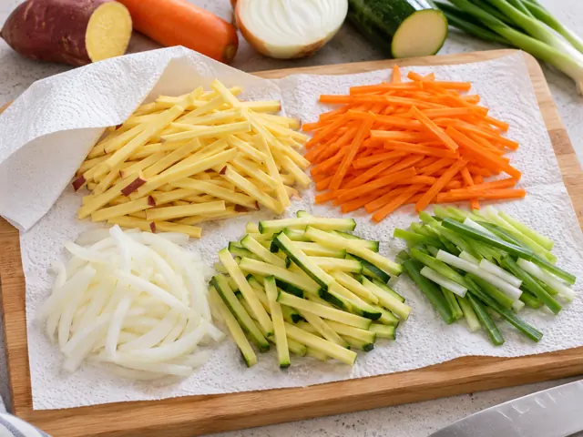

# Crispy Korean Vegetable Fritters (Yachae Twigim)

Korean snack-shop style vegetable fritters made with thin strips of sweet potato, onion, carrot, zucchini, and scallion coated in a light, cold batter and fried until crisp.

- Servings: 2
- Categories: Snack, Korean

## Ingredients

- Sweet potato — 1/2 medium (about 120g)
- Onion — 1/2 (about 100g)
- Carrot — 1/2 (about 70g)
- Korean zucchini (or regular zucchini) — 1/3 (about 100g)
- Scallion — 1/2 stalk (about 35g)
- Korean tempura flour mix (twigim-garu) — 120g (100g for batter, 20g for dusting)
- Cold water — 140ml (for batter)
- Neutral frying oil — About 700ml (adjust to pot size)
- Soy sauce — 1 tbsp (for dipping sauce)
- Vinegar — 1 tsp (for dipping sauce)
- Water — 1 tbsp (for dipping sauce)

## Instructions

1. Peel the 1/2 sweet potato and 1/2 carrot. Cut the sweet potato, carrot, 1/2 onion, and 1/3 zucchini into matchsticks about 5cm long and 3mm thick. Cut the 1/2 scallion stalk into similar lengths. Pat all vegetables thoroughly dry with paper towels.

   

2. In a bowl, gently mix 100g Korean tempura flour mix with 140ml cold water using chopsticks, stirring just 10–15 times. A few small lumps are fine. Prepare the batter immediately before frying.

   

3. Sprinkle the remaining 20g tempura flour evenly over the prepared vegetables and toss lightly. Pour in the batter from step 2 and fold just 2–3 times, until the vegetables are lightly coated rather than submerged.

   

4. Pour about 700ml neutral oil into a deep pot, never filling it more than halfway, and heat to 170–175°C (340–350°F). Gather loose clusters of about 1/3 cup (80–100g) vegetable mixture each to make 6–8 fritters. Fry in batches without crowding for 3–4 minutes, turning once halfway through, until golden and the sweet potato is cooked.

   

5. Transfer the fritters to a wire rack and let excess oil drain for 1–2 minutes. Stir together 1 tbsp soy sauce, 1 tsp vinegar, and 1 tbsp water for the dipping sauce. Serve immediately while crisp.

   

The canonical data for this recipe is [recipe.json](recipe.json).
