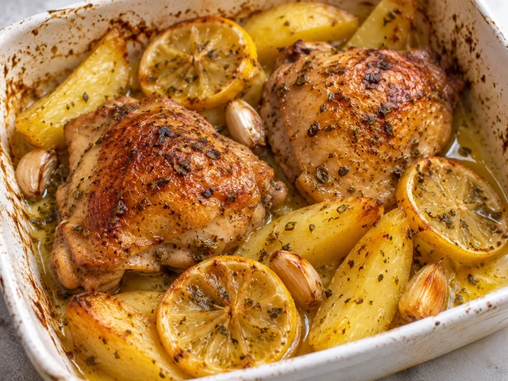
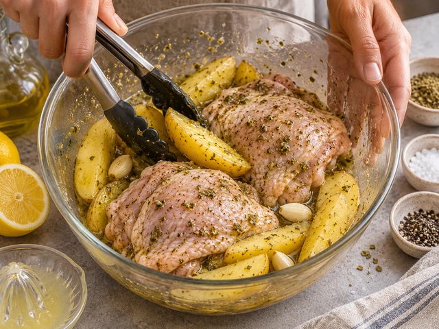
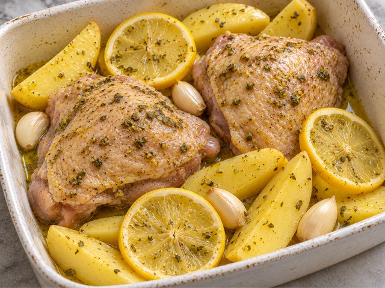
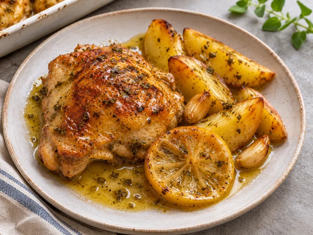

# Greek Lemon Chicken and Potatoes (Kotopoulo Lemonato)

A Greek one-pan dinner of chicken thighs and potatoes roasted in lemon, olive oil, and oregano until deeply golden.

- Servings: 2
- Categories: Main Dish

## Ingredients

- Bone-in chicken thighs — 2 pieces (500g total)
- Potatoes — 400g
- Lemon — 1
- Garlic cloves — 3
- Olive oil — 3 tbsp
- Dried oregano — 1 tsp
- Paprika — 1/2 tsp
- Salt — 3/4 tsp
- Ground black pepper — 1/4 tsp
- Water — 100ml

## Instructions

1. Preheat the oven to 200°C (conventional). Scrub 400g potatoes and cut into thick wedges; peel 3 garlic cloves. Halve the lemon, juice one half, and thinly slice the other half.

   

2. Mix 3 tbsp olive oil, juice from 1/2 lemon, 1 tsp dried oregano, 1/2 tsp paprika, 3/4 tsp salt, and 1/4 tsp pepper. Toss the 2 chicken thighs, potatoes, and garlic in the marinade.

   

3. Spread the potatoes in a baking dish and arrange the chicken skin-side up. Tuck in the slices from the remaining 1/2 lemon and pour 100ml water around the edge.

   

4. Roast at 200°C for 35 minutes. Turn the potatoes, baste the chicken with pan juices, and roast 15–20 minutes longer. Check that the thickest part of the chicken reaches at least 74°C and the potatoes are tender.

   

5. Let rest for 5 minutes, then divide the chicken and potatoes between 2 plates and serve with the roasted lemon and pan juices.

   

The canonical data for this recipe is [recipe.json](recipe.json).
