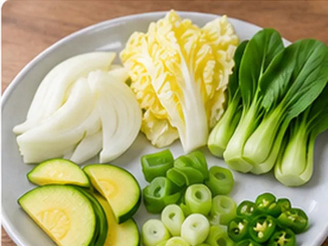
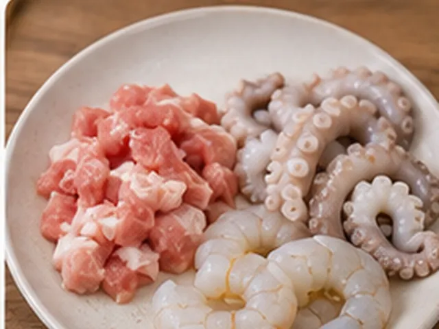
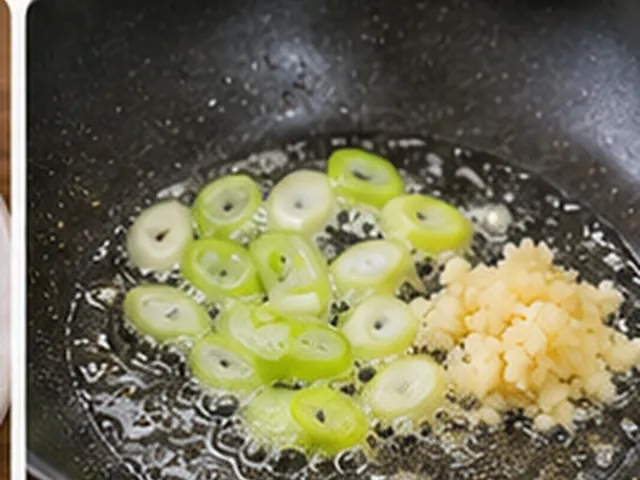
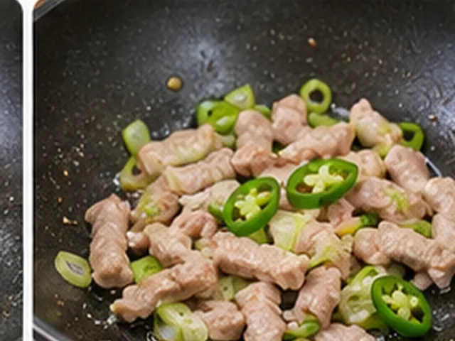
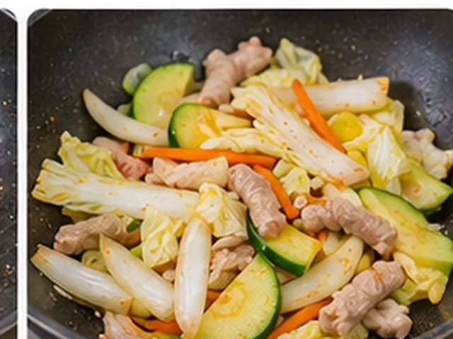
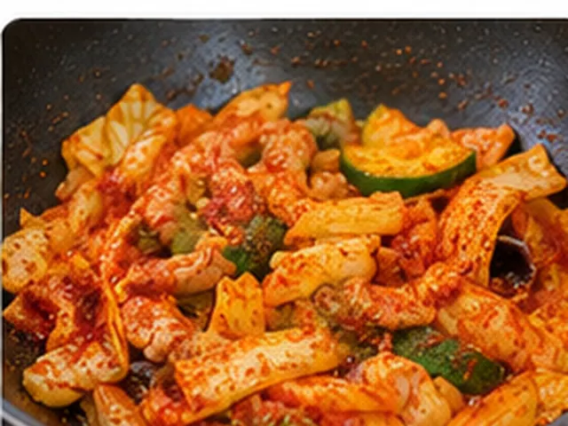
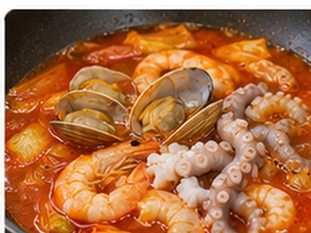
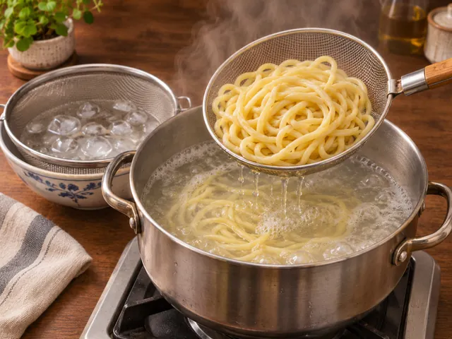
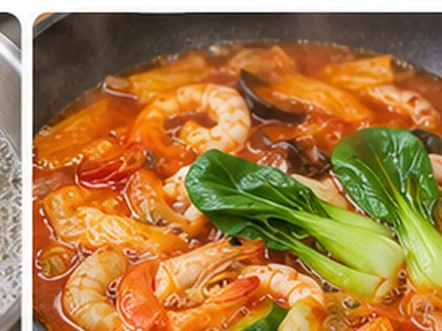

# 이연복식 옛날 짬뽕

대파와 마늘로 향을 낸 뒤 돼지고기와 청양고추를 볶고, 낙지·새우·바지락으로 시원한 해물 국물을 만드는 얼큰한 옛날 짬뽕입니다.

- 분량: 2인분
- 분류: 면요리, 중식

## 재료

- 중화면(생면) — 300g
- 돼지고기(등심 또는 앞다리살) — 50g
- 손질한 낙지 — 1마리(약 120g)
- 새우 — 6마리
- 해감한 바지락 — 7~8개
- 양파 — 1/4개
- 배추 — 3잎
- 애호박 — 1/4개
- 청경채 — 2포기
- 대파 — 1대
- 청양고추 — 1개
- 다진 마늘 — 1/2큰술
- 식용유 — 3큰술
- 진간장 — 1/2큰술
- 고춧가루 — 2큰술
- 물(고춧가루 볶을 때) — 2큰술
- 물(국물용) — 600ml
- 치킨파우더(분말) — 1/2큰술
- 소금 — 1/3큰술(간 보고 조절)
- 굴소스 — 1과 1/2큰술
- 물(면 삶기용) — 약 2L

## 조리 방법

1. 양파 1/4개, 배추 3잎, 애호박 1/4개, 청경채 2포기, 대파 1대, 청양고추 1개를 씻고 먹기 좋게 썰어 준비합니다. 청경채는 다른 채소와 섞지 않고 따로 둡니다.

   

2. 손질한 낙지 1마리와 돼지고기 50g을 큼직하게 썹니다. 새우 6마리는 껍질과 내장을 손질하고, 해감한 바지락 7~8개는 깨끗이 씻어 둡니다.

   

3. 깊은 팬에 식용유 3큰술을 두르고 중불에서 대파와 다진 마늘 1/2큰술을 약 1분간 볶아 향을 냅니다. 이때 청양고추는 아직 넣지 않습니다.

   

4. 돼지고기 50g과 청양고추 1개를 함께 넣고 중강불에서 돼지고기 겉면이 익을 때까지 약 1~2분간 볶습니다.

   

5. 진간장 1/2큰술을 팬 가장자리에 둘러 넣고, 청경채를 제외한 채소인 양파·배추·애호박을 넣어 센 불에서 2분 정도 볶습니다.

   

6. 채소가 숨이 죽으면 불을 약하게 줄이고 고춧가루 2큰술과 물 2큰술을 넣습니다. 약 20~30초간 골고루 섞어 볶되 고춧가루가 타지 않게 합니다.

   

7. 국물용 물 600ml를 추가로 붓고 치킨파우더 1/2큰술, 굴소스 1과 1/2큰술, 소금 1/3큰술을 넣습니다. 소금은 처음에 절반 정도만 넣고 마지막에 맛보며 조절해도 좋습니다. 바지락 7~8개, 새우 6마리, 낙지를 넣고 끓인 뒤 중불에서 3~5분간 해산물이 완전히 익을 때까지 끓입니다.

   

8. 다른 냄비에 면 삶기용 물 약 2L를 끓여 중화면 300g을 포장지에 표시된 시간에 맞춰 삶습니다. 삶은 면은 체에 밭쳐 물기를 뺍니다.

   

9. 육수가 끓는 동안 따로 둔 청경채 2포기를 넣고 30~60초간 살짝 데칩니다. 국물을 맛보고 필요한 만큼 소금으로 간을 마무리합니다. 끝까지 열리지 않은 바지락은 버립니다.

   

10. 삶은 중화면을 그릇 두 개에 나눠 담고 뜨거운 해물 육수와 건더기, 청경채를 골고루 얹어 바로 냅니다.

   

## 참고

[이연복의 복주머니 – 옛날 짬뽕](https://www.youtube.com/watch?v=3FBKcTumM5w)을 참고하여 10단계 조리 순서를 유지하고 가정에서 재현하기 쉽게 계량과 설명을 정리했습니다.

---

The canonical data for this recipe is [recipe.json](recipe.json).