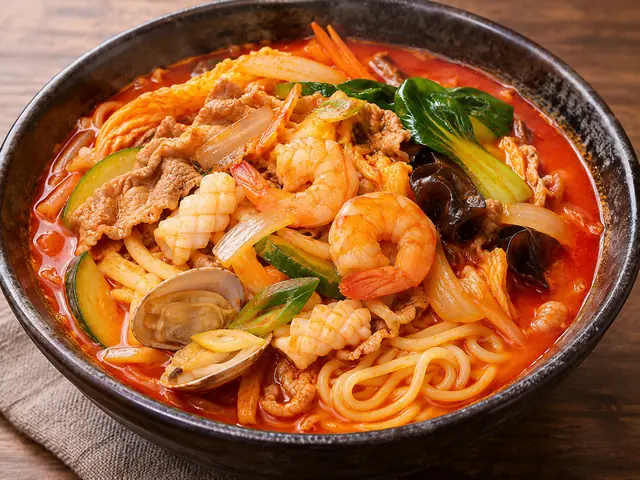
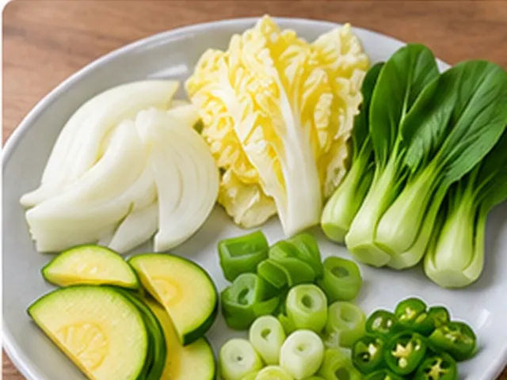
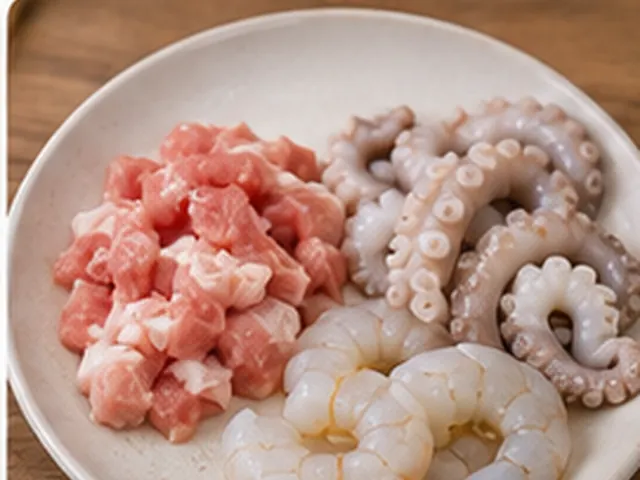
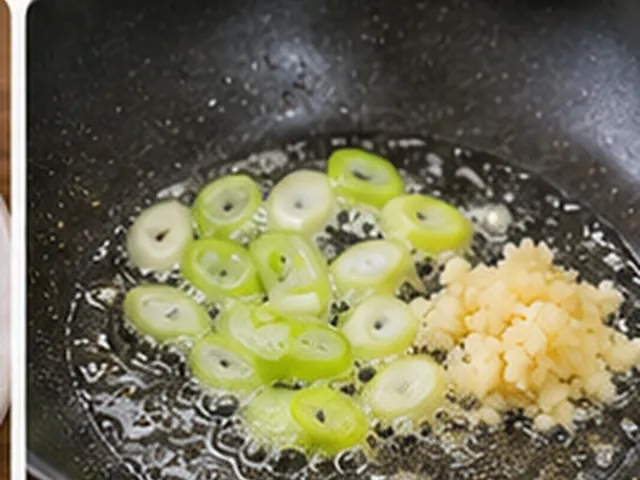
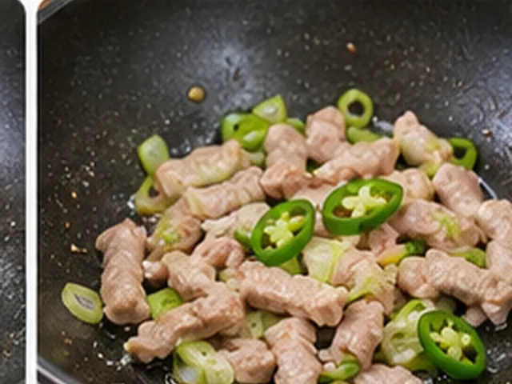
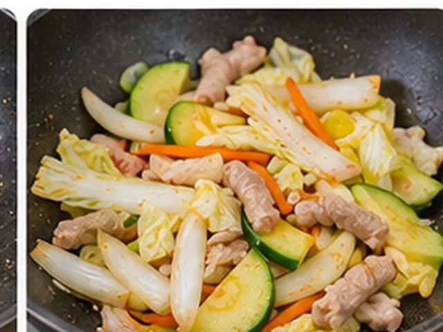
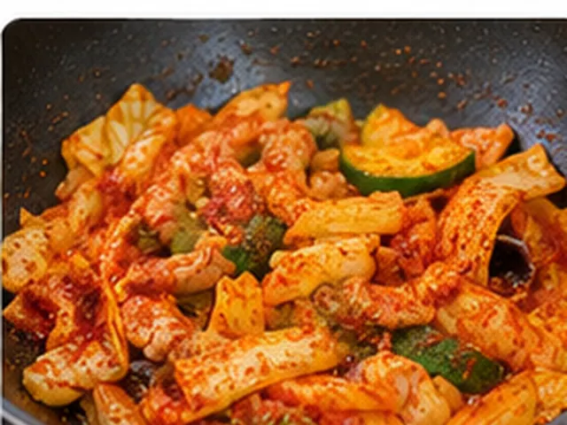
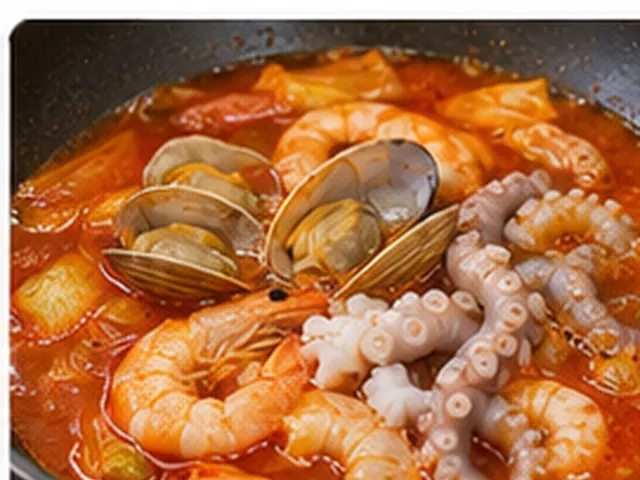
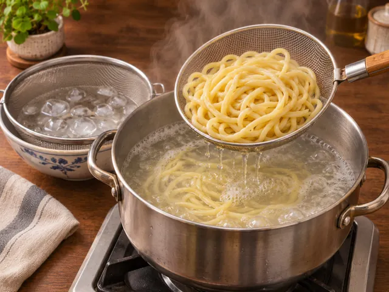
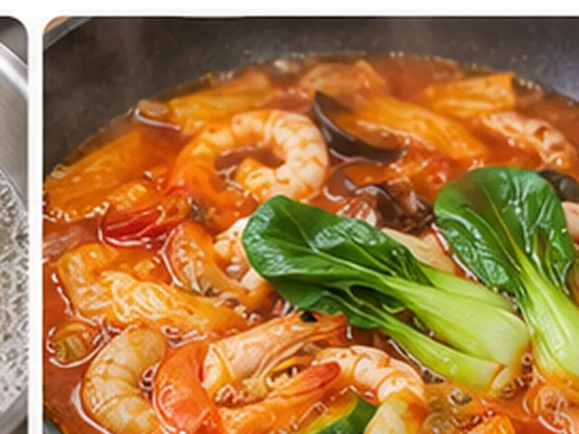

# Lee Yeon-bok–Style Old-School Seafood Jjamppong

Old-school spicy Korean-Chinese noodles made by frying green onion and garlic first, adding pork and chili next, and simmering octopus, shrimp and clams in the savory broth.

- Servings: 2
- Categories: Noodles/Pasta, Chinese

## Ingredients

- Fresh Chinese-style wheat noodles — 300g
- Pork loin or shoulder — 50g
- Cleaned small octopus (nakji) — 1 (about 120g)
- Shrimp — 6
- Purged short-neck clams (bajirak) — 7–8
- Onion — 1/4
- Napa cabbage — 3 leaves
- Korean zucchini (aehobak) or zucchini — 1/4
- Bok choy — 2 small heads
- Green onion (daepa) — 1 stalk
- Cheongyang chili pepper — 1
- Minced garlic — 1/2 tbsp
- Neutral cooking oil — 3 tbsp
- Soy sauce — 1/2 tbsp
- Korean red pepper flakes (gochugaru) — 2 tbsp
- Water (for blooming pepper flakes) — 2 tbsp
- Water (for broth) — 600ml
- Chicken stock powder — 1/2 tbsp
- Salt — 1/3 tbsp (adjust to taste)
- Oyster sauce — 1 1/2 tbsp
- Water (for cooking noodles) — about 2L

## Instructions

1. Wash and cut 1/4 onion, 3 napa cabbage leaves, 1/4 zucchini, 2 small heads of bok choy, 1 green onion stalk, and 1 Cheongyang chili pepper into suitable pieces. Keep the bok choy separate from the other vegetables.

   

2. Cut 1 cleaned small octopus and 50g pork into generous bite-size pieces. Peel and devein 6 shrimp, and rinse 7–8 purged clams.

   

3. Heat 3 tbsp cooking oil in a deep pan over medium heat. Stir-fry the green onion and 1/2 tbsp minced garlic for about 1 minute until fragrant. Do not add the chili pepper yet.

   

4. Add the 50g pork and the sliced Cheongyang chili pepper together. Stir-fry over medium-high heat for 1–2 minutes, until the outside of the pork is cooked.

   

5. Drizzle 1/2 tbsp soy sauce along the edge of the pan. Add the onion, napa cabbage and zucchini, leaving out the bok choy, and stir-fry over high heat for about 2 minutes.

   

6. When the vegetables soften, reduce the heat and add 2 tbsp Korean red pepper flakes and 2 tbsp water. Stir-fry for 20–30 seconds, taking care not to burn the flakes.

   

7. Pour in an additional 600ml water, 1/2 tbsp chicken stock powder, 1 1/2 tbsp oyster sauce, and up to 1/3 tbsp salt. You can start with half the salt and adjust later. Add the 7–8 clams, 6 shrimp and prepared octopus. Bring to a boil, then cook at a simmer for 3–5 minutes, until the seafood is fully cooked.

   

8. In another pot, boil about 2L water. Cook 300g fresh Chinese-style noodles according to the package directions, then drain well.

   

9. While the broth is boiling, add the reserved 2 heads of bok choy and blanch for 30–60 seconds. Taste the broth and adjust the salt if needed. Discard any clams that remain unopened.

   

10. Divide the cooked noodles between two bowls. Ladle over the hot seafood broth, toppings and bok choy, and serve immediately.

   

## Reference

Adapted for home cooking from [Lee Yeon-bok’s old-school jjamppong video](https://www.youtube.com/watch?v=3FBKcTumM5w). The 10-step cooking order follows the provided reference.

---

The canonical data for this recipe is [recipe.json](recipe.json).