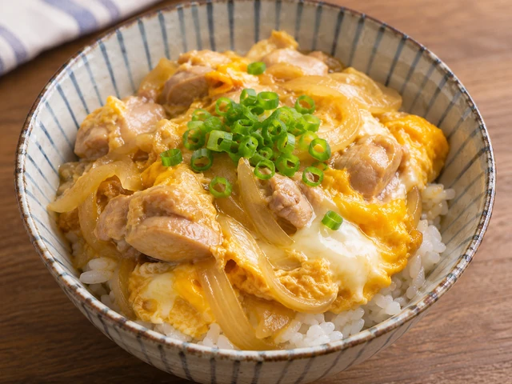
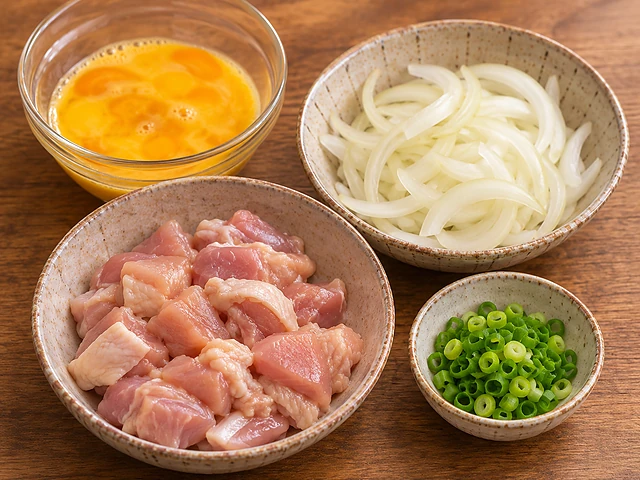
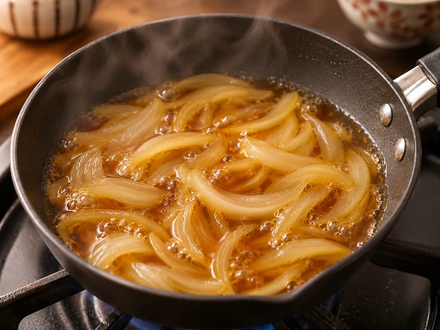
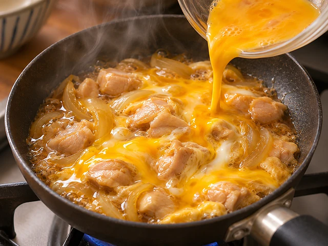
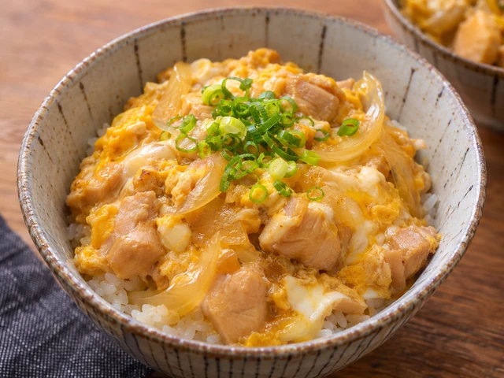

# 오야코동 (닭고기 달걀덮밥)

달콤짭조름한 다시 육수에 닭고기와 양파를 익히고 달걀을 부드럽게 얹은 일본식 덮밥입니다.

- 분량: 2인분
- 분류: 메인 요리, 한그릇요리, 일식

## 재료

- 닭다리살 (뼈·껍질 제거) — 250g
- 달걀 — 3개
- 양파 — 1/2개 (약 100g)
- 따뜻한 밥 — 2공기
- 물 — 150ml
- 다시 분말 — 1/2작은술
- 간장 — 2큰술
- 미림 — 2큰술
- 설탕 — 1작은술
- 쪽파 (선택) — 1줄기

## 조리 방법

1. 닭다리살 250g을 한입 크기로 썰고 양파 1/2개는 얇게 채 썹니다. 달걀 3개는 젓가락으로 노른자만 살짝 풀어 흰자와 노른자가 완전히 섞이지 않게 둡니다. 선택한 쪽파 1줄기는 송송 썹니다.

   

2. 작은 팬에 물 150ml, 다시 분말 1/2작은술, 간장 2큰술, 미림 2큰술, 설탕 1작은술을 넣고 끓입니다. 양파를 넣어 중불에서 3분 익힙니다.

   

3. 닭고기를 양파 위에 고루 펼쳐 넣고 뚜껑을 덮어 약 5~7분 익힙니다. 닭고기의 중심 온도가 74℃ 이상이 되도록 익히고, 국물이 너무 졸면 불을 조금 낮춥니다.

   

4. 풀어둔 달걀의 2/3를 둥글게 붓고 30초 익힌 뒤 나머지를 붓습니다. 뚜껑을 덮고 약불에서 1~2분 더 익혀 달걀이 부드럽게 굳도록 합니다. 완전히 익힌 달걀을 선호한다면 조금 더 가열합니다.

   

5. 따뜻한 밥 2공기를 각각 그릇에 담고 닭고기·달걀·양파를 국물과 함께 반씩 올립니다. 쪽파를 준비했다면 뿌려 바로 먹습니다.

   

The canonical data for this recipe is [recipe.json](recipe.json).
