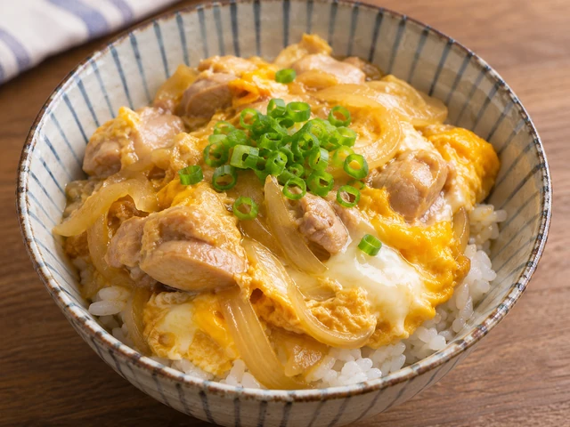
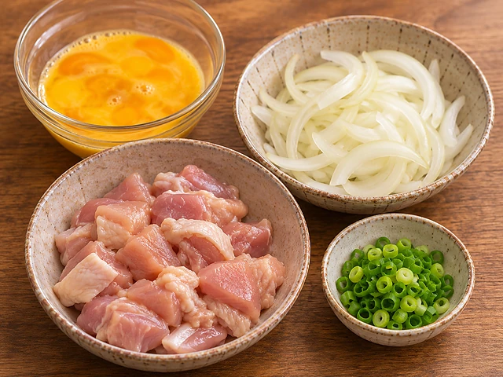
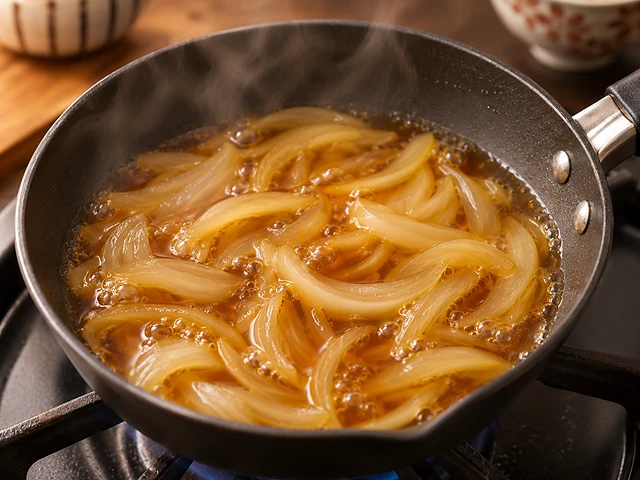
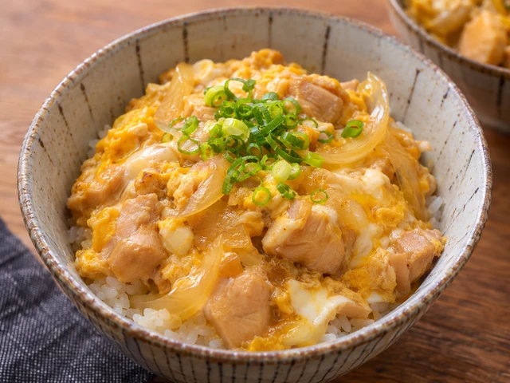

# Oyakodon (Japanese Chicken and Egg Rice Bowl)

A comforting Japanese rice bowl topped with chicken, onion, and softly set eggs simmered in a savory-sweet dashi sauce.

- Servings: 2
- Categories: Main Dish, Rice Bowl, Japanese

## Ingredients

- Boneless skinless chicken thigh — 250g
- Eggs — 3
- Onion — 1/2 (about 100g)
- Warm cooked rice — 2 bowls
- Water — 150ml
- Instant dashi powder — 1/2 tsp
- Soy sauce — 2 tbsp
- Mirin — 2 tbsp
- Sugar — 1 tsp
- Spring onion (optional) — 1 stalk

## Instructions

1. Cut 250g chicken thigh into bite-size pieces and thinly slice 1/2 onion. Lightly break the yolks of 3 eggs with chopsticks, leaving streaks of white. Slice the optional spring onion.

   

2. Bring 150ml water, 1/2 tsp instant dashi, 2 tbsp soy sauce, 2 tbsp mirin, and 1 tsp sugar to a simmer in a small pan. Add the onion and cook over medium heat for 3 minutes.

   

3. Spread the chicken evenly over the onion, cover, and simmer for about 5–7 minutes until the chicken reaches an internal temperature of at least 74°C. Reduce the heat if the sauce evaporates too quickly.

   

4. Pour in two-thirds of the eggs in a circular motion and cook 30 seconds. Add the rest, cover, and gently cook for 1–2 minutes until softly set; cook longer if you prefer fully set eggs.

   

5. Divide 2 bowls of warm rice between serving bowls and spoon half the chicken, egg, onion, and broth over each. Scatter with optional spring onion and serve immediately.

   

The canonical data for this recipe is [recipe.json](recipe.json).
