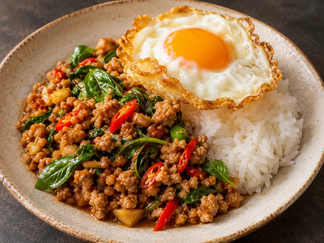
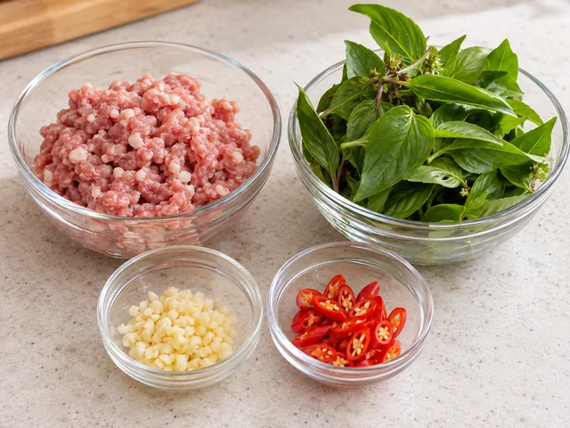
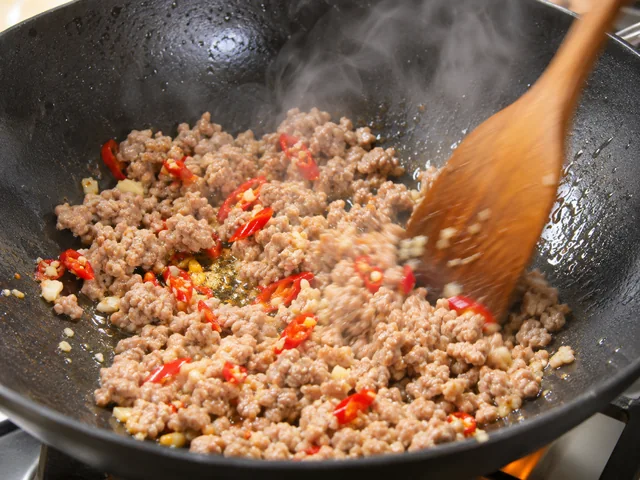
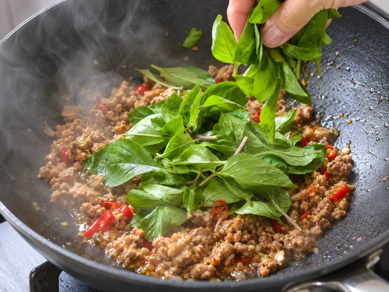
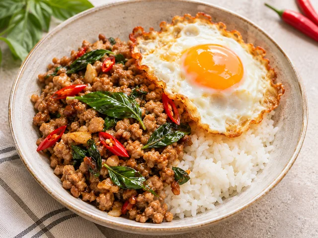

# 태국식 돼지고기 바질볶음 (팟 카파오 무)

다진 돼지고기를 마늘·고추·바질·짭조름한 소스와 재빨리 볶아 달걀 프라이와 밥을 곁들인 태국식 덮밥입니다.

- 분량: 2인분
- 분류: 메인 요리, 한그릇요리

## 재료

- 다진 돼지고기 — 300g
- 홀리 바질 (없으면 타이 바질) — 20g
- 마늘 — 4쪽
- 타이 고추 — 2개
- 굴소스 — 1큰술
- 피시소스 — 1큰술
- 간장 — 1작은술
- 설탕 — 1작은술
- 물 — 2큰술
- 식용유 — 2큰술
- 달걀 — 2개
- 따뜻한 밥 — 2공기

## 조리 방법

1. 마늘 4쪽과 타이 고추 2개를 잘게 다집니다. 홀리 바질 20g을 씻어 물기를 털고, 작은 그릇에 굴소스 1큰술·피시소스 1큰술·간장 1작은술·설탕 1작은술·물 2큰술을 섞습니다.

   

2. 달군 팬에 식용유 1큰술을 두르고 달걀 2개를 각각 깨뜨려 가장자리가 바삭해질 때까지 부친 뒤 접시에 옮깁니다.

   

3. 같은 팬에 남은 식용유 1큰술을 두르고 마늘과 고추를 20초 볶습니다. 다진 돼지고기 300g을 넣어 주걱으로 풀어가며 4–5분 볶고 완전히 익힙니다(중심 온도 71℃ 이상).

   

4. 섞어둔 소스를 붓고 1–2분 볶아 고기에 골고루 입힙니다. 불을 끄기 직전에 바질 20g을 넣고 20–30초만 살짝 뒤섞어 숨을 죽입니다.

   

5. 따뜻한 밥 2공기를 각각 접시에 담고 돼지고기 바질볶음을 반씩 올립니다. 준비한 달걀 프라이 1개씩을 곁들여 바로 먹습니다.

   

The canonical data for this recipe is [recipe.json](recipe.json).
