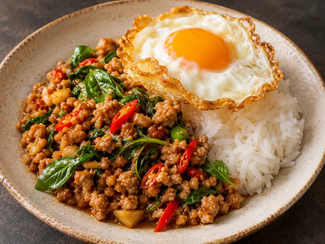
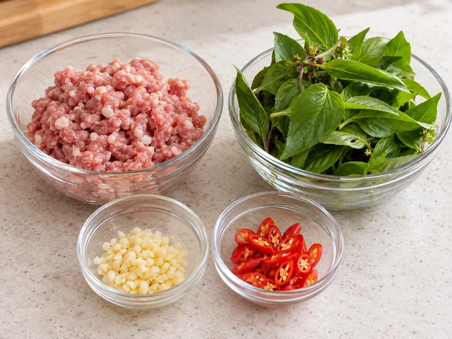
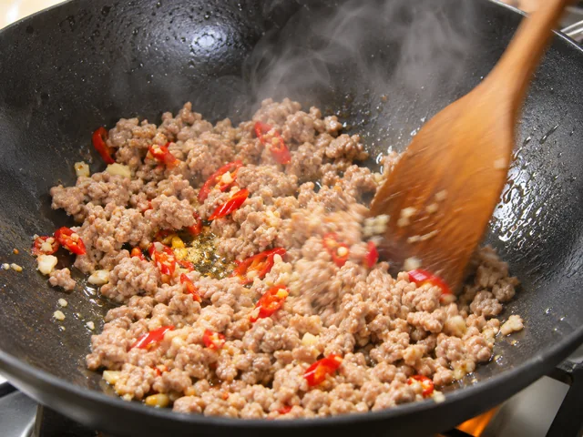
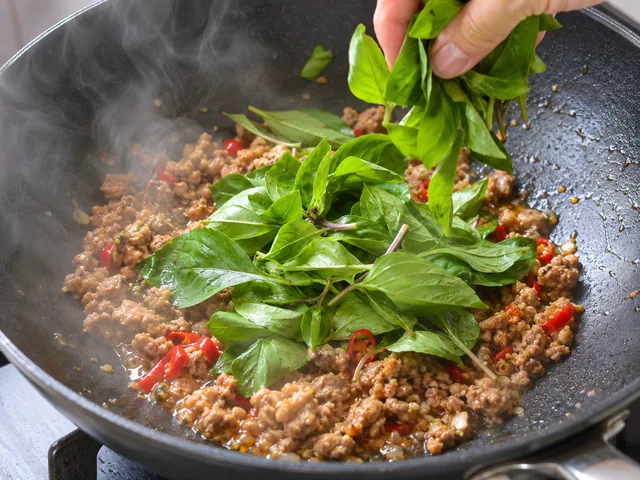

# Pad Kra Pao Moo (Thai Basil Pork Rice)

A punchy Thai rice dish of minced pork stir-fried with garlic, chilies, basil, and savory sauce, finished with a fried egg.

- Servings: 2
- Categories: Main Dish, Rice Bowl

## Ingredients

- Ground pork — 300g
- Holy basil (or Thai basil) — 20g
- Garlic cloves — 4
- Thai chilies — 2
- Oyster sauce — 1 tbsp
- Fish sauce — 1 tbsp
- Soy sauce — 1 tsp
- Sugar — 1 tsp
- Water — 2 tbsp
- Neutral oil — 2 tbsp
- Eggs — 2
- Warm cooked rice — 2 bowls

## Instructions

1. Finely chop 4 garlic cloves and 2 Thai chilies. Rinse and dry 20g holy basil. In a small bowl, mix 1 tbsp oyster sauce, 1 tbsp fish sauce, 1 tsp soy sauce, 1 tsp sugar, and 2 tbsp water.

   

2. Heat 1 tbsp neutral oil in a pan and fry 2 eggs until the edges are crisp. Transfer to a plate.

   

3. Add the remaining 1 tbsp neutral oil to the pan, stir-fry the garlic and chilies for 20 seconds, then add 300g ground pork. Break it up and cook 4–5 minutes until fully cooked (at least 71°C internally).

   

4. Pour in the sauce and stir-fry for 1–2 minutes until it coats the pork. Add the 20g basil just before turning off the heat and toss for 20–30 seconds until wilted.

   

5. Divide the 2 bowls of warm rice between plates, top each with half the basil pork, and finish each with 1 fried egg. Serve hot.

   

The canonical data for this recipe is [recipe.json](recipe.json).
