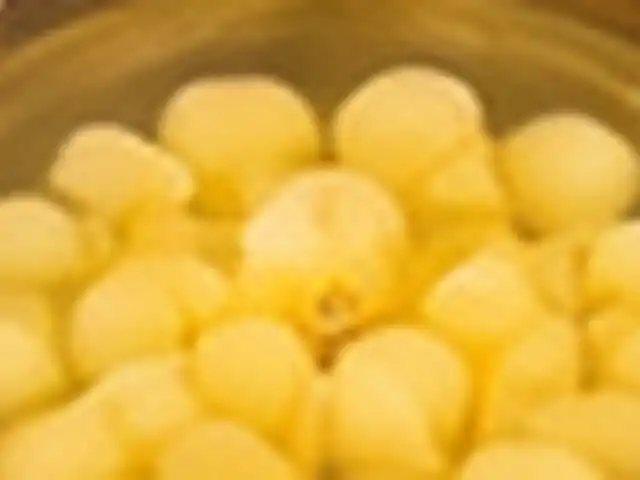
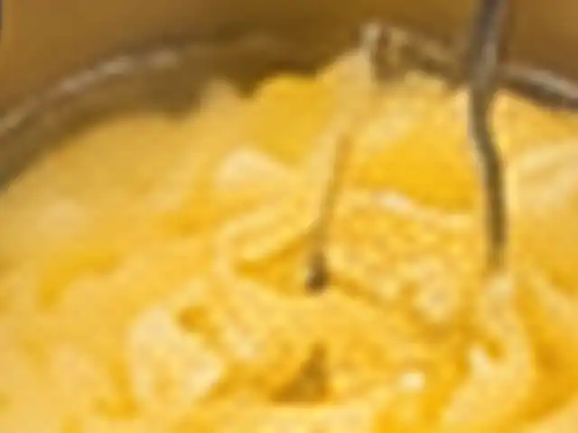
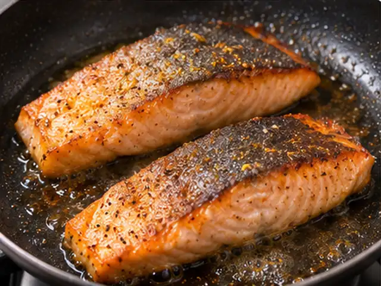
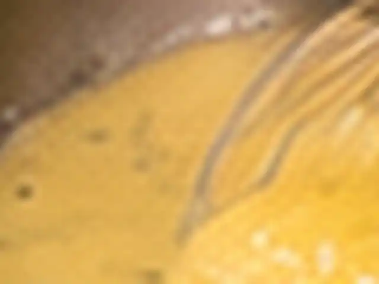
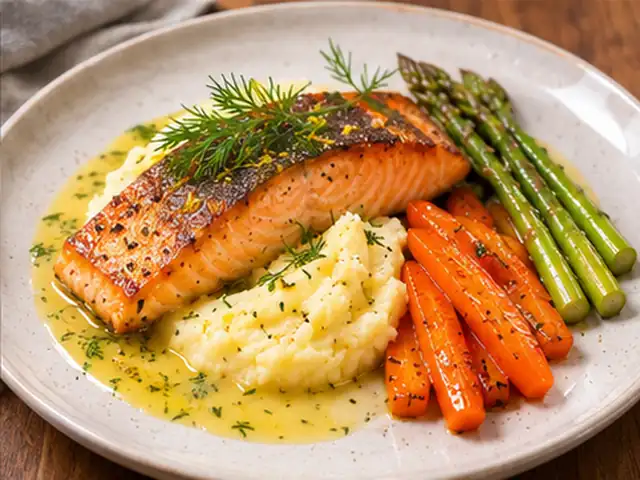

# 레몬 딜 버터 소스를 곁들인 연어구이 플레이트

바삭하게 구운 연어에 레몬 딜 버터 소스를 곁들이고, 부드러운 감자퓨레·허니버터 당근·갈릭 아스파라거스를 한 접시에 담은 프랑스식 비스트로 스타일 요리입니다. 조리 시간 약 40~45분.

- 분량: 2인분
- 분류: 메인 요리, 양식

## 재료

- 연어 필레(가급적 껍질 포함) — 2조각 (각 160~200g)
- 감자(전분 많은 품종) — 500g
- 당근 — 2개 (약 200g)
- 그린 아스파라거스 — 8~10대
- 샬롯 — 1/2개
- 마늘 — 1쪽
- 생딜(또는 파슬리) — 잘게 다진 것 1큰술
- 레몬 — 1개 (즙 1큰술·제스트 1/2작은술 및 당근용 약간)
- 무염버터(감자퓨레용) — 40g
- 무염버터(당근용) — 15g
- 무염버터(아스파라거스용) — 10g
- 차가운 무염버터(소스용) — 35g
- 우유 — 80~100ml
- 꿀 — 2작은술
- 올리브오일(연어용) — 1큰술
- 올리브오일(아스파라거스용) — 1작은술
- 드라이 화이트와인(또는 물·채소육수) — 40ml
- 물(당근용) — 60ml
- 물(감자 삶는 용도) — 감자가 잠길 만큼
- 소금 — 약 1작은술 (나누어 사용, 취향에 맞게 조절)
- 후춧가루 — 약간

## 조리 방법

1. 감자 500g은 껍질을 벗겨 약 3cm 크기로 썰고, 찬물에 잠기도록 담아 소금 약간을 넣어 끓입니다. 끓기 시작하면 중약불에서 15~20분, 젓가락이 쉽게 들어갈 때까지 삶습니다.

   

2. 감자가 삶아지는 동안 당근 2개는 길쭉하게 4~6등분하거나 1cm 두께로 어슷썰고, 아스파라거스 8~10대는 질긴 밑동 2~3cm를 잘라냅니다. 샬롯 1/2개와 생딜 1큰술은 곱게 다지고 마늘 1쪽은 편 썹니다. 레몬즙과 제스트도 준비합니다.

   

3. 팬에 손질한 당근, 물 60ml, 소금 한 꼬집을 넣고 뚜껑을 덮어 중불에서 5~7분 익힙니다. 뚜껑을 열어 물을 거의 졸인 뒤 버터 15g과 꿀 2작은술을 넣고 1~2분 굴려 윤기를 냅니다. 레몬즙 몇 방울로 단맛을 조절합니다.

   

4. 삶은 감자의 물을 완전히 버리고 약불에서 30~60초 수분을 날립니다. 뜨거울 때 포테이토 라이서나 매셔로 으깬 뒤 버터 40g과 따뜻하게 데운 우유 80~100ml를 조금씩 섞습니다. 소금으로 간하고 원하면 체에 내립니다. 핸드블렌더는 사용하지 않습니다.

   

5. 팬에 올리브오일 1작은술을 두르고 아스파라거스를 중강불에서 3~5분 굽습니다. 버터 10g과 편 썬 마늘을 넣어 30~60초 더 볶고 소금과 후추로 간합니다. 아삭함이 남을 정도로 익혀 따뜻하게 둡니다.

   

6. 작은 소스팬에 다진 샬롯과 화이트와인 40ml를 넣고 중불에서 와인이 1~2큰술 정도 남을 때까지 졸인 다음 불을 끕니다. 버터를 넣기 전까지 이 소스 베이스를 둡니다.

   

7. 연어 2조각의 표면 물기를 키친타월로 잘 닦아 소금·후추로 간합니다. 중강불로 달군 팬에 올리브오일 1큰술을 두르고 껍질이 아래로 가게 올려 처음 15~20초 가볍게 누릅니다. 움직이지 않고 4~6분 굽다가 뒤집어 2~4분 더 구운 뒤 2분간 휴지시킵니다. 두께에 맞춰 시간을 조절하고 완전히 익히려면 중심온도 63°C를 확인합니다.

   

8. 연어가 휴지하는 동안 소스 베이스를 아주 약하게 데우고 차가운 버터 35g을 2~3조각씩 나누어 넣으면서 거품기로 저어 유화시킵니다. 레몬즙 1큰술, 제스트 1/2작은술, 다진 딜 1큰술을 넣고 소금·후추로 간합니다. 버터를 넣은 뒤에는 끓이지 않습니다.

   

9. 따뜻한 접시 한쪽에 감자퓨레를 타원형으로 펼치고 연어를 껍질이 위로 향하도록 올립니다. 당근과 아스파라거스를 나란히 담고 레몬 딜 버터 소스를 연어 주변과 퓨레 가장자리에 1~2큰술씩 두릅니다. 바삭한 껍질 위에 소스를 많이 붓지 않습니다.

   

---

The canonical data for this recipe is [recipe.json](recipe.json).
