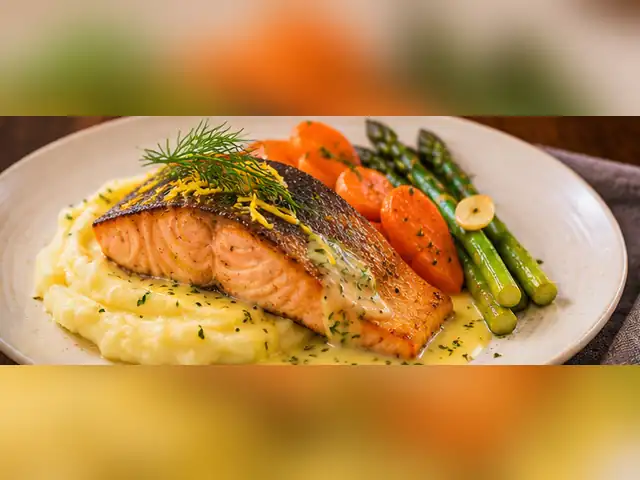
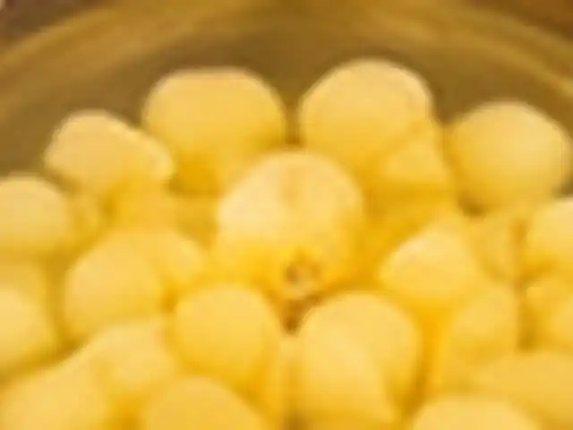
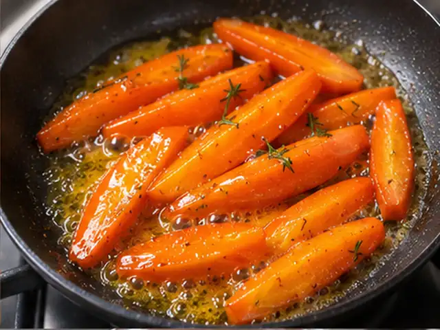
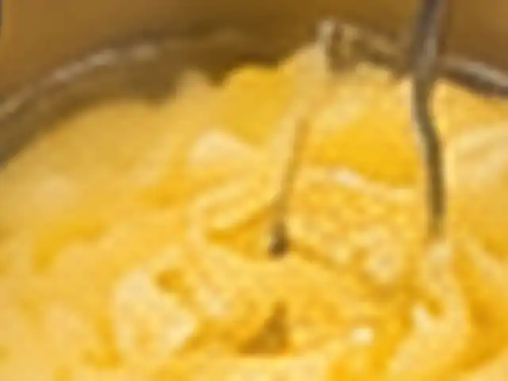
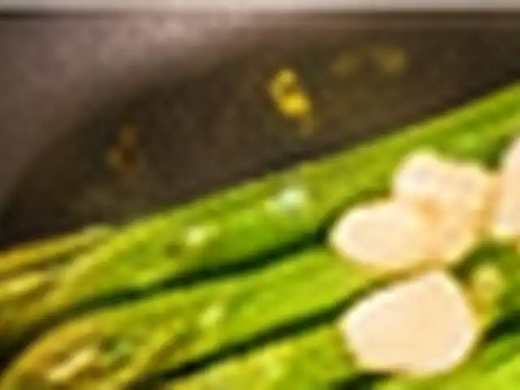
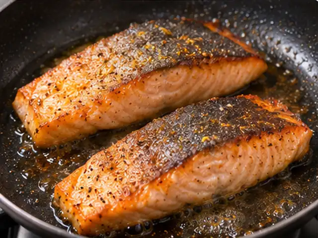
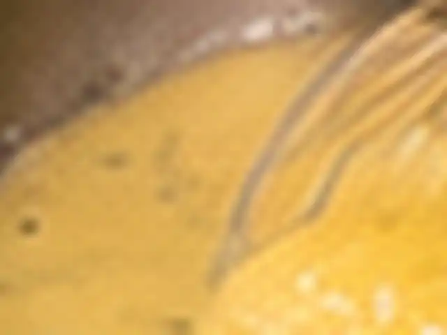
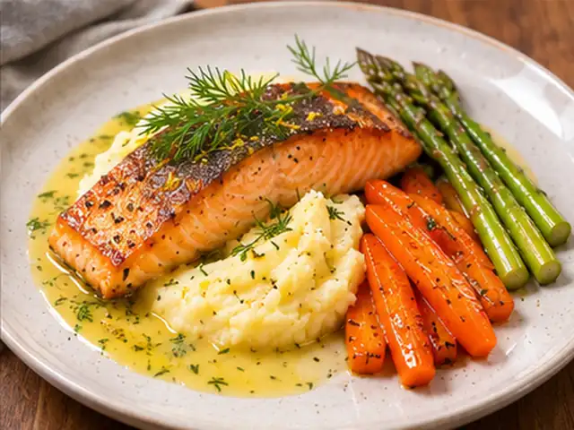

# Pan-Seared Salmon Bistro Plate with Lemon-Dill Butter Sauce

Crisp-skinned pan-seared salmon with silky potato purée, honey-butter glazed carrots, garlic asparagus, and a bright lemon-dill butter sauce. A French bistro-inspired dinner in about 40–45 minutes.

- Servings: 2
- Categories: Main Dish, Western

## Ingredients

- Salmon fillets, preferably skin-on — 2 pieces (160–200g each)
- Starchy potatoes (e.g., mehligkochend) — 500g
- Carrots — 2 (about 200g)
- Green asparagus — 8–10 spears
- Shallot — 1/2
- Garlic — 1 clove
- Fresh dill (or parsley), finely chopped — 1 tbsp
- Lemon — 1 (1 tbsp juice, 1/2 tsp zest, plus a few drops for carrots)
- Unsalted butter, for potato purée — 40g
- Unsalted butter, for carrots — 15g
- Unsalted butter, for asparagus — 10g
- Cold unsalted butter, for sauce — 35g
- Milk — 80–100ml
- Honey — 2 tsp
- Olive oil, for salmon — 1 tbsp
- Olive oil, for asparagus — 1 tsp
- Dry white wine (or water/vegetable stock) — 40ml
- Water, for carrots — 60ml
- Water, for boiling potatoes — Enough to cover
- Salt — About 1 tsp total, divided; adjust to taste
- Ground pepper — To taste

## Directions

1. Peel 500g potatoes, cut into roughly 3cm pieces, and cover with cold water. Add a little salt and bring to a boil. Simmer over medium-low heat for 15–20 minutes, until a skewer slides through easily.

   

2. While the potatoes cook, quarter or sixth the 2 carrots lengthwise (or cut into 1cm diagonal slices). Trim 2–3cm off the woody bases of 8–10 asparagus spears. Finely chop 1/2 shallot and 1 tbsp dill, thinly slice 1 garlic clove, and prepare the lemon juice and zest.

   

3. Put the carrots, 60ml water, and a pinch of salt in a pan. Cover and cook over medium heat for 5–7 minutes. Uncover and reduce almost all the water, then toss with 15g butter and 2 tsp honey for 1–2 minutes until glossy. Add a few drops of lemon juice to balance the sweetness.

   

4. Drain the cooked potatoes thoroughly and return them to low heat for 30–60 seconds to evaporate moisture. While hot, mash with a ricer or masher. Mix in 40g butter, then gradually add 80–100ml warm milk until smooth. Season with salt; pass through a sieve if desired. Avoid using a hand blender, which can make the purée gluey.

   

5. Heat 1 tsp olive oil in a skillet over medium-high heat. Sear the asparagus for 3–5 minutes. Add 10g butter and the sliced garlic; sauté another 30–60 seconds. Season with salt and pepper, leaving the asparagus slightly crisp. Keep warm.

   

6. In a small saucepan, simmer the minced shallot and 40ml dry white wine over medium heat until only about 1–2 tbsp liquid remains. Turn off the heat and reserve the reduction as the sauce base.

   

7. Pat the 2 salmon fillets dry and season with salt and pepper. Heat 1 tbsp olive oil in a skillet over medium-high heat. Put the fillets in skin-side down, pressing gently for the first 15–20 seconds. Cook undisturbed for 4–6 minutes; flip and cook for another 2–4 minutes. Rest for 2 minutes. Adjust to thickness and check for an internal temperature of 63°C if cooking fully through for food safety.

   

8. While the salmon rests, gently rewarm the shallot-wine reduction over very low heat. Whisk in 35g cold butter a few pieces at a time to emulsify. Stir in 1 tbsp lemon juice, 1/2 tsp zest, and 1 tbsp chopped dill; season with salt and pepper. Do not let the butter sauce boil.

   

9. Spread the potato purée into an oval on warm plates and place the salmon on top with the crisp skin facing up. Arrange the glazed carrots and asparagus beside it. Spoon 1–2 tbsp lemon-dill butter sauce around the salmon and the edges of the purée, keeping most of it off the crisp skin.

   

---

The canonical data for this recipe is [recipe.json](recipe.json).
