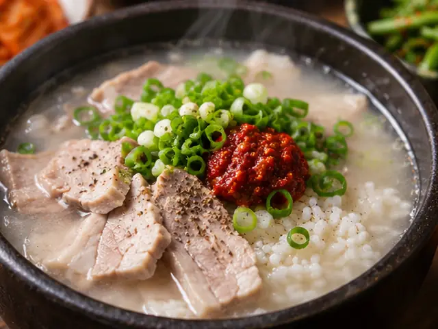

# 돼지국밥

돼지 등뼈와 앞다리살을 은근히 끓여 만든 육수에 밥과 부드러운 돼지고기를 담고 새우젓으로 간을 맞추는 부산식 돼지국밥입니다.

- 분량: 2인분
- 분류: 한그릇요리, 국/찌개, 한식

## 재료

- 돼지 등뼈 — 600g
- 돼지고기 앞다리살 (덩어리) — 400g
- 물 — 2.5L + 데칠 물 적당량
- 대파 — 2대
- 양파 — 1개
- 통마늘 — 6쪽
- 생강 — 10g
- 통후추 — 1/2작은술
- 밥 — 2공기
- 부추 — 40g
- 새우젓 — 2작은술
- 소금 — 1/2작은술
- 고춧가루 — 1작은술

## 조리 방법

1. 돼지 등뼈를 찬물에 30분 정도 담가 핏물을 뺀 뒤, 끓는 물에 5분간 데칩니다. 건져서 흐르는 물에 씻어 불순물을 제거합니다.
2. 큰 냄비에 데친 등뼈, 앞다리살, 물 2.5L, 대파 1대, 양파 1개, 통마늘 6쪽, 생강 10g, 통후추 1/2작은술을 넣습니다. 센불로 끓이다가 거품을 걷어내고 약불로 줄입니다.
3. 뚜껑을 살짝 덮고 50~60분 끓입니다. 앞다리살이 속까지 충분히 익고 부드러워지면 먼저 건져 식힙니다.
4. 등뼈와 향신 채소는 50~60분 더 은근히 끓입니다. 국물이 지나치게 졸면 물을 조금 보충하고, 체에 걸러 건더기와 기름을 걷어낸 뒤 육수 약 1.2L를 준비합니다.
5. 삶은 앞다리살은 먹기 좋은 두께로 얇게 썹니다. 남은 대파 1대는 송송 썰고 부추 40g은 4~5cm 길이로 자릅니다.
6. 밥 2공기를 각각 그릇에 담고 썰어 놓은 돼지고기를 나누어 올립니다. 뜨겁게 데운 육수를 약 600ml씩 붓습니다.
7. 대파와 부추를 나누어 올립니다. 새우젓 2작은술, 소금 1/2작은술, 고춧가루 1작은술은 한꺼번에 넣지 말고 각자 입맛에 맞게 조금씩 추가합니다.

---

The canonical data for this recipe is [recipe.json](recipe.json).
