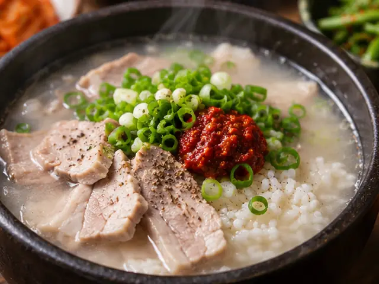

# Dwaeji Gukbap (Korean Pork and Rice Soup)

Busan-style pork and rice soup made with a gently simmered pork-bone broth and tender sliced pork, seasoned at the table with salted shrimp.

- Servings: 2
- Categories: One-bowl meal, Soup/Stew, Korean

## Ingredients

- Pork backbone bones — 600g
- Pork shoulder (whole piece) — 400g
- Water — 2.5L, plus extra for blanching
- Large green onions (daepa) — 2 stalks
- Onion — 1
- Garlic cloves — 6
- Fresh ginger — 10g
- Whole black peppercorns — 1/2 tsp
- Cooked rice — 2 bowls
- Garlic chives (buchu) — 40g
- Salted fermented shrimp (saeujeot) — 2 tsp
- Salt — 1/2 tsp
- Korean red pepper flakes (gochugaru) — 1 tsp

## Instructions

1. Soak the pork bones in cold water for about 30 minutes to draw out blood. Blanch them in boiling water for 5 minutes, then rinse under running water to remove impurities.
2. Place the blanched bones, pork shoulder, 2.5L water, 1 green onion, onion, garlic, ginger, and peppercorns in a large pot. Bring to a boil, skim off the foam, then reduce to low heat.
3. Simmer with the lid slightly ajar for 50–60 minutes. Once the pork shoulder is cooked through and tender, remove it and let it cool.
4. Continue gently simmering the bones and aromatics for another 50–60 minutes. Add a little water if the liquid reduces too much. Strain out solids, skim excess fat, and reserve about 1.2L of broth.
5. Thinly slice the cooked pork. Finely slice the remaining green onion and cut the garlic chives into 4–5cm lengths.
6. Divide the cooked rice between two bowls and arrange the sliced pork on top. Pour about 600ml of piping-hot broth into each bowl.
7. Divide the green onion and chives between the bowls. Serve the salted shrimp, salt, and gochugaru on the side, adding each a little at a time to taste.

---

The canonical data for this recipe is [recipe.json](recipe.json).
