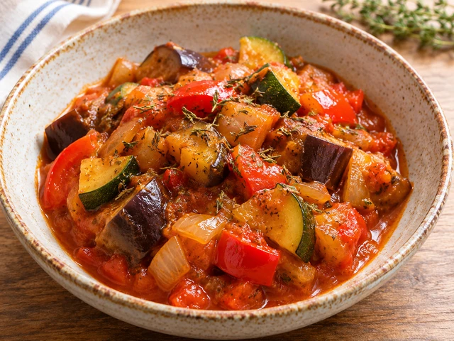
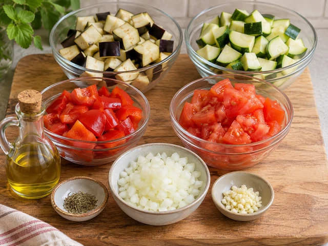
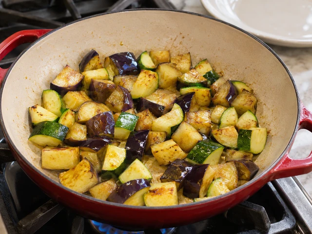
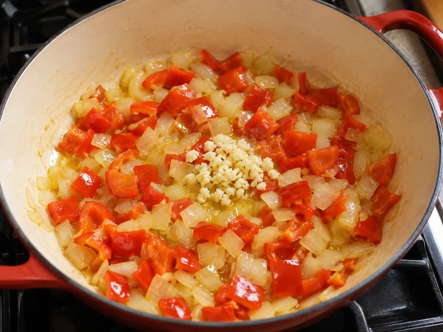
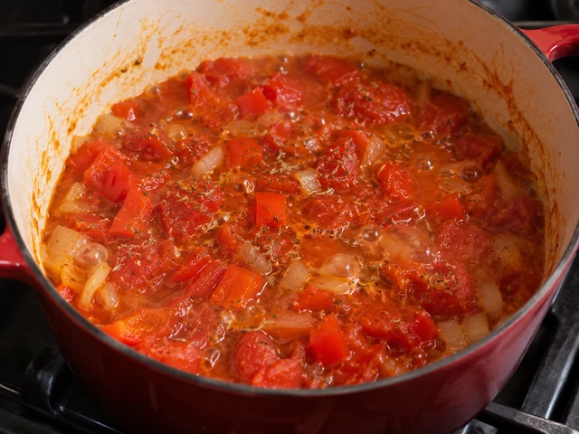
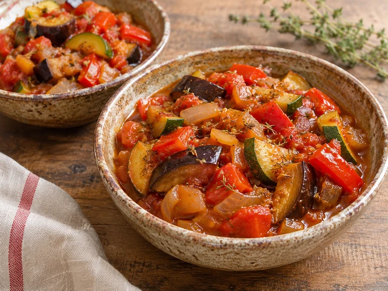

# 프랑스식 라타투이

가지·주키니·파프리카·토마토를 올리브오일과 허브로 천천히 익혀 채소의 단맛을 살린 프로방스식 스튜입니다.

- 분량: 2인분
- 분류: 반찬, 메인 요리

## 재료

- 가지 — 1개 (약 250g)
- 주키니 — 1개 (약 250g)
- 빨간 파프리카 — 1개 (약 180g)
- 토마토 — 3개 (약 350g)
- 양파 — 1개 (약 150g)
- 마늘 — 2쪽
- 올리브오일 — 3큰술
- 말린 타임 — 1/2작은술
- 소금 — 3/4작은술
- 후춧가루 — 1/4작은술
- 물 — 50ml

## 조리 방법

1. 가지 1개, 주키니 1개, 파프리카 1개, 토마토 3개를 2cm 정도 크기로 썹니다. 양파 1개는 잘게 썰고 마늘 2쪽은 다집니다.

   

2. 넓은 냄비에 올리브오일 2큰술을 중강불로 달군 뒤 가지와 주키니를 넣고 5~6분 볶아 가장자리가 노릇해지면 접시에 덜어둡니다.

   

3. 같은 냄비에 남은 올리브오일 1큰술을 넣고 양파와 파프리카를 4분 볶습니다. 마늘을 넣고 30초 더 볶아 향을 냅니다.

   

4. 토마토와 물 50ml, 말린 타임 1/2작은술을 넣어 끓인 다음 중약불에서 10분 동안 뚜껑을 살짝 열고 끓입니다.

   

5. 덜어둔 가지와 주키니를 다시 넣고 15분 더 뭉근하게 익힙니다. 소금 3/4작은술과 후춧가루 1/4작은술을 넣어 간을 맞추고 2그릇에 나누어 담습니다.

   

The canonical data for this recipe is [recipe.json](recipe.json).
