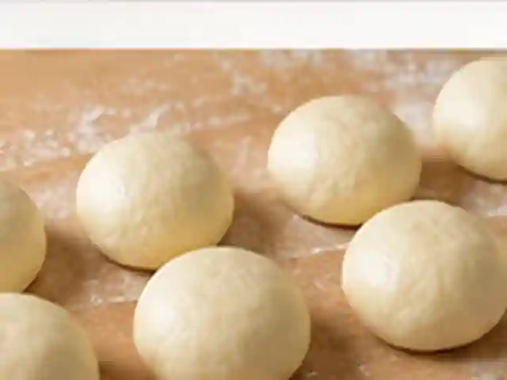
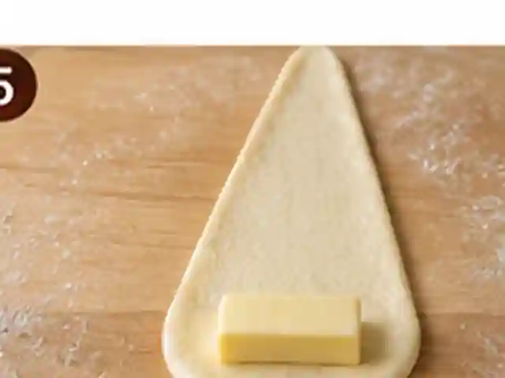

# 소금빵

속에 넣은 버터가 굽는 동안 녹아 바닥은 바삭하고 속은 부드러운, 고소하고 짭짤한 일본식 소금빵(시오빵)입니다.

- 분량: 2인분(작은 소금빵 8개)
- 분류: 간식/디저트, 베이킹

## 재료

- 강력분 — 300g
- 우유(미지근한 것) — 180ml
- 설탕 — 18g
- 소금(반죽용) — 5g
- 인스턴트 드라이이스트 — 4g
- 무염버터(반죽용, 실온) — 20g
- 무염버터(속에 넣는 용도, 차가운 것) — 64g(8g씩 8조각)
- 굵은 소금(토핑용) — 약 2g
- 물(표면에 바르는 용도) — 약 1작은술

## 조리 방법

1. 큰 볼에 강력분 300g, 설탕 18g, 소금 5g, 인스턴트 드라이이스트 4g을 넣고 섞습니다. 미지근한 우유 180ml를 부어 한 덩어리로 만든 뒤 약 5분 치댑니다. 실온 무염버터 20g을 넣고 반죽이 매끈하고 탄력 있어질 때까지 5~10분 더 치댑니다.

   

2. 반죽을 둥글게 정리해 볼에 넣고 덮어 따뜻한 곳(약 26~28°C)에서 60~90분, 부피가 약 2배가 될 때까지 1차 발효합니다.

   

3. 발효된 반죽을 가볍게 눌러 가스를 빼고 8등분합니다. 각각 둥글게 만든 뒤 마르지 않게 덮어 15분간 휴지시킵니다. 그동안 차가운 무염버터 64g을 8g씩 길쭉하게 나눠 준비합니다.

   

4. 반죽을 하나씩 약 25cm 길이의 길쭉한 삼각형으로 밀어 편 뒤 넓은 쪽에 차가운 버터 8g을 올립니다. 버터를 감싸듯 끝까지 느슨하지 않게 돌돌 말고 마지막 끝부분을 아래로 향하게 놓습니다. 나머지도 반복합니다.

   

5. 종이호일을 깐 팬에 소금빵 8개를 간격을 두고 올리고 덮어 따뜻한 곳에서 35~50분간, 약 1.5배로 부풀 때까지 2차 발효합니다. 발효가 끝날 무렵 오븐을 210°C로 충분히 예열합니다. 표면에 물을 아주 얇게 바르고 굵은 소금 약 2g을 골고루 나눠 뿌립니다.

   

6. 예열된 210°C 오븐 중간 칸에서 약 15~18분간, 표면과 밑면이 진한 황금색이 될 때까지 굽습니다. 구운 뒤 팬에서 꺼내 식힘망에 5분 정도 식혀 바닥이 눅눅해지지 않게 합니다. 굽는 동안 버터가 조금 흘러나오는 것은 자연스럽습니다.

   

---

The canonical data for this recipe is [recipe.json](recipe.json).
