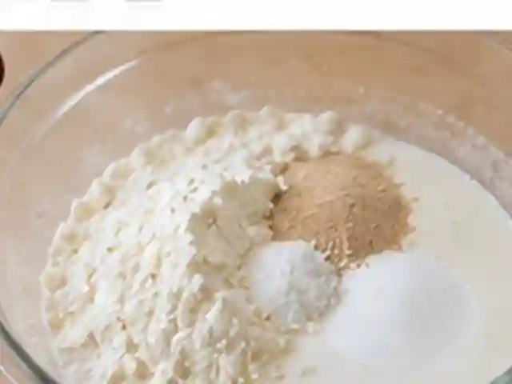
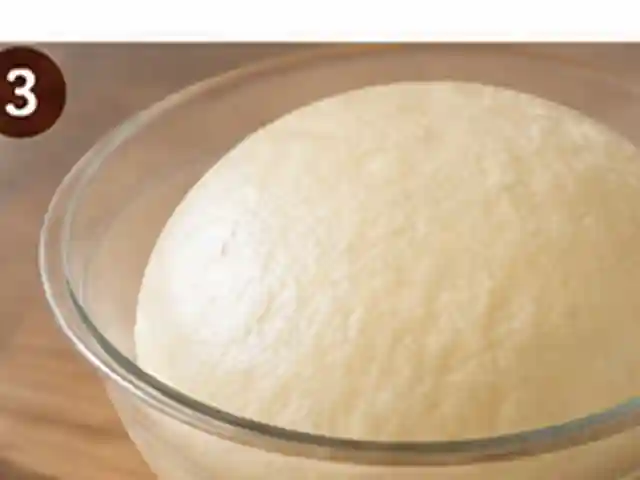

# Salt Bread (Shio Pan)

Japanese-style salted butter rolls with a crisp buttery bottom, a soft interior, and a sprinkle of coarse salt.

- Servings: 2 (8 small rolls)
- Categories: Snacks/Desserts, Baking

## Ingredients

- Bread flour — 300 g
- Lukewarm milk — 180 ml
- Sugar — 18 g
- Salt (for dough) — 5 g
- Instant dry yeast — 4 g
- Unsalted butter (for dough, softened) — 20 g
- Unsalted butter (for filling, chilled) — 64 g (8 pieces of 8 g)
- Coarse salt (for topping) — about 2 g
- Water (for brushing) — about 1 tsp

## Directions

1. Mix 300 g bread flour, 18 g sugar, 5 g salt, and 4 g instant yeast in a large bowl. Pour in 180 ml lukewarm milk and mix into a dough. Knead for about 5 minutes, then incorporate 20 g softened unsalted butter and knead for another 5–10 minutes until smooth and elastic.

   

2. Shape the dough into a ball, place in a bowl, and cover. Let rise in a warm place (around 26–28°C / 79–82°F) for 60–90 minutes until roughly doubled in volume.

   

3. Gently press the dough to release excess gas and divide into 8 equal pieces. Shape each into a ball, cover, and rest for 15 minutes. Meanwhile, cut 64 g chilled unsalted butter into eight long 8 g pieces.

   

4. Roll each dough piece into a long, narrow triangle about 25 cm (10 inches) long. Place an 8 g piece of cold butter at the wide end, enclose the butter, and roll toward the tip snugly. Position the tip underneath each roll. Repeat with the remaining dough.

   

5. Space the 8 rolls on a parchment-lined baking sheet and cover. Let rise in a warm spot for 35–50 minutes until about 1.5 times their size. Toward the end, thoroughly preheat the oven to 210°C (410°F). Lightly brush the tops with about 1 tsp water and distribute about 2 g coarse salt over the rolls.

   

6. Bake on the middle rack at 210°C (410°F) for 15–18 minutes, until deeply golden on top and underneath. Transfer to a wire rack and cool for about 5 minutes to keep the bottoms crisp. Some butter leaking during baking is normal.

   

---

The canonical data for this recipe is [recipe.json](recipe.json).
