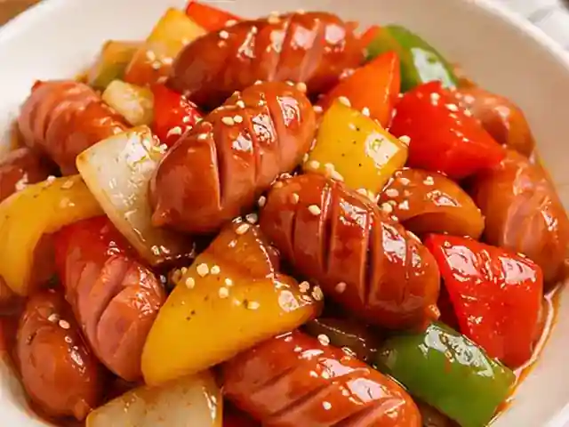
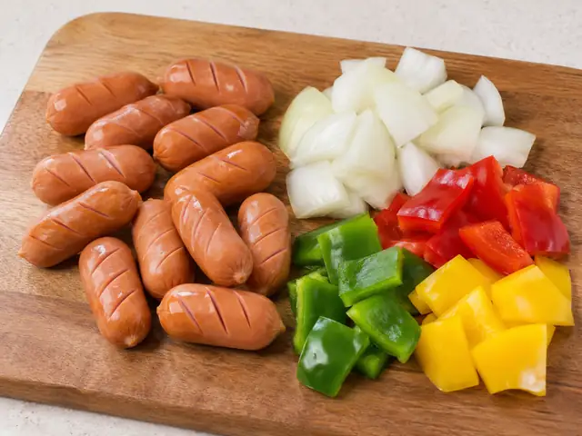
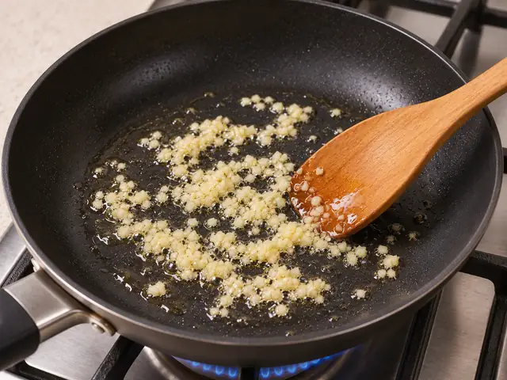
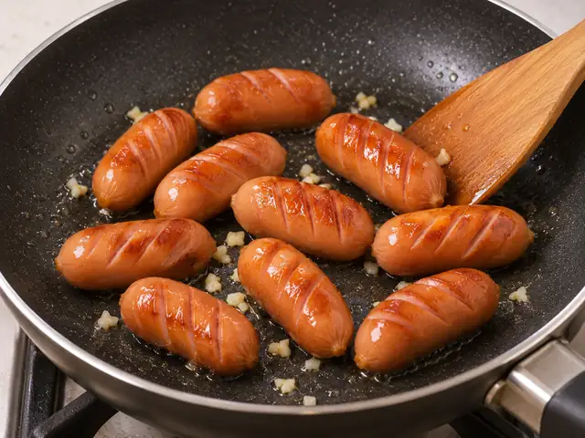
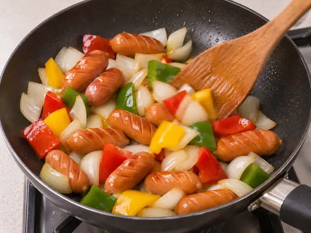
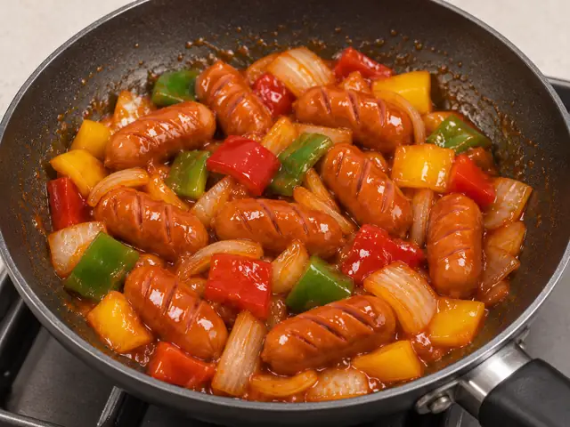
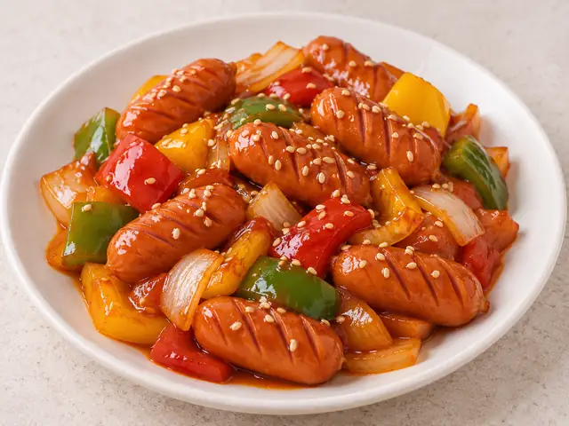

# Sausage and Vegetable Stir-Fry (Ssoya)

A quick Korean side dish of Vienna sausages and crisp vegetables coated in a sweet, mildly spicy ketchup-gochujang sauce.

- Servings: 2
- Categories: Side Dish, Korean

## Ingredients

- Vienna sausages — 250 g
- Onion — 1/2
- Red bell pepper — 1/2
- Yellow bell pepper — 1/2
- Green bell pepper — 1/2
- Cooking oil — 1 tbsp
- Minced garlic — 1 tsp
- Ketchup — 3 tbsp
- Gochujang (Korean red pepper paste) — 1/2 tbsp
- Soy sauce — 1 tsp
- Sugar — 1 tsp
- Water — 2 tbsp
- Toasted sesame seeds — 1 tsp

## Directions

1. Make 2 or 3 shallow diagonal cuts on each Vienna sausage. Cut the onion and red, yellow, and green bell peppers into bite-size pieces.

   

2. Mix the ketchup, gochujang, soy sauce, sugar, and water in a small bowl to make the sauce.

   

3. Heat the cooking oil in a pan over medium heat. Add the minced garlic and stir-fry for 20 to 30 seconds until fragrant.

   

4. Add the Vienna sausages and stir-fry for about 2 minutes until lightly browned.

   

5. Add the onion and cook for 1 minute. Add the red, yellow, and green bell peppers and stir-fry for another 1 to 2 minutes, keeping them slightly crisp.

   

6. Pour in the sauce and stir-fry over medium-low heat for 1 to 2 minutes until everything is evenly coated and the sauce thickens slightly.

   

7. Turn off the heat and sprinkle with the toasted sesame seeds to finish.

   

The canonical data for this recipe is [recipe.json](recipe.json).
