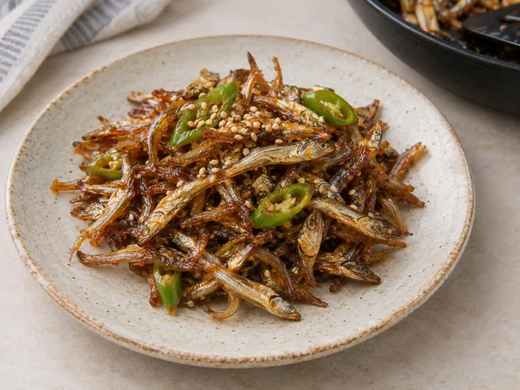
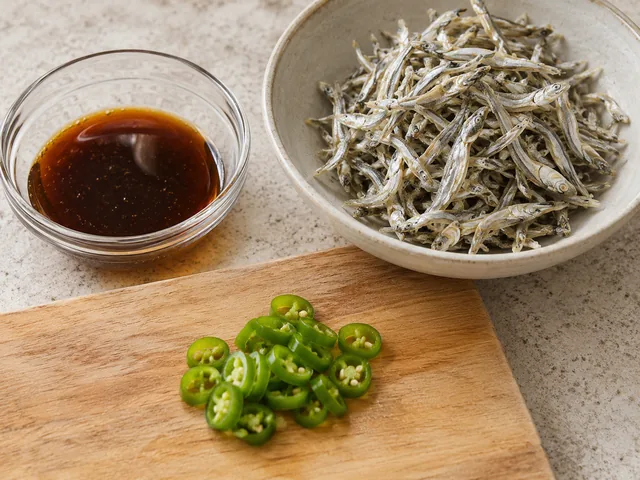
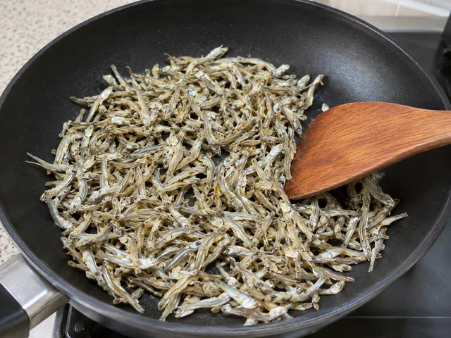
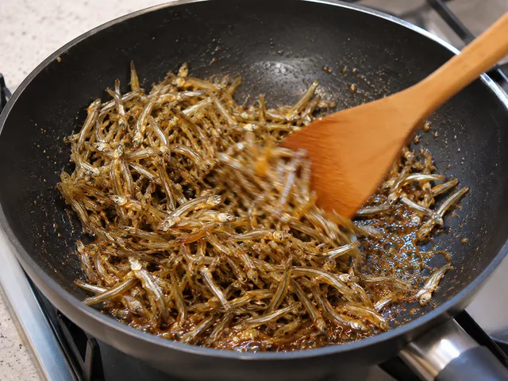
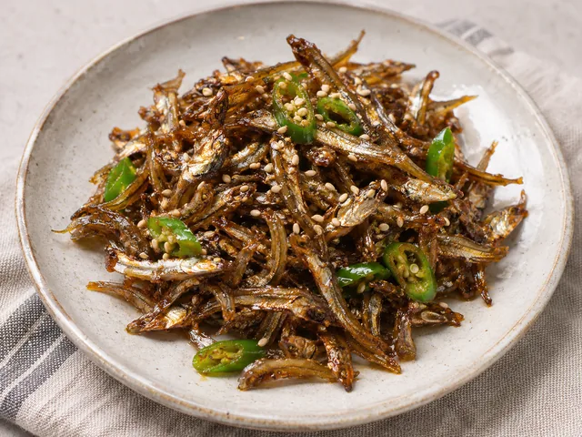

# Soy Sauce Stir-Fried Anchovies (Myeolchi Bokkeum)

Crisp medium dried anchovies coated in a sweet and savory soy glaze, a Korean side dish.

- Servings: 2
- Tags: Side Dish, Korean

## Ingredients

- Medium dried anchovies (myeolchi) — 1 cup
- Cheongyang chili (hot green chili) — 1
- Neutral cooking oil — 3 tbsp
- Korean starch syrup (mulyeot) — 2 tbsp
- Brown sugar — 1/2 tbsp
- Korean brewed soy sauce (jin-ganjang) — 1 tbsp
- Toasted sesame oil — 1 tbsp
- Toasted sesame seeds — 1 tsp

## Instructions

1. Mix 1 tbsp soy sauce, 2 tbsp starch syrup and 1/2 tbsp brown sugar in a bowl. Halve the hot green chili lengthwise and cut it into 3 mm slices.

   

2. Prepare 1 cup of medium dried anchovies. If using large stock anchovies, remove the heads, guts and thick backbones. Heat 3 tbsp neutral oil in a skillet over medium heat and stir-fry the anchovies until crisp and less fishy-smelling.

   

3. Push the anchovies to one side of the skillet and reduce the heat to low. Pour the sauce into the empty area, stirring until the sugar dissolves and bubbles form throughout.

   

4. Toss the anchovies with the bubbling sauce, then add the sliced green chili and stir-fry briefly. Keep stirring so the glaze does not burn.

   

5. Turn off the heat, stir in 1 tbsp toasted sesame oil and 1 tsp toasted sesame seeds, then transfer to a plate and let cool before serving.

   

The canonical data for this recipe is [recipe.json](recipe.json).
