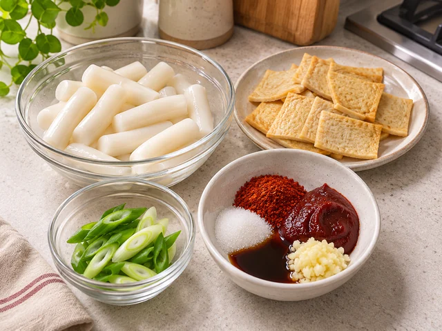
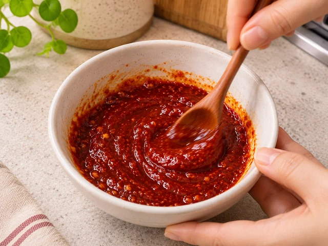
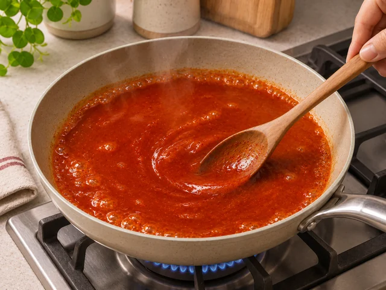
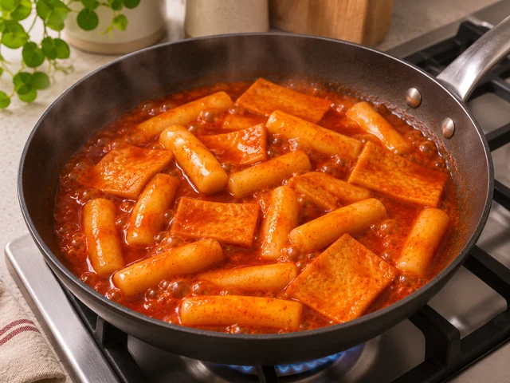

# 떡볶이

쫄깃한 떡과 어묵을 매콤달콤한 고추장 양념에 자작하게 끓여 내는 기본 떡볶이입니다.

- 분량: 2인분
- 분류: 한식, 간식/디저트, 야식

## 재료

- 떡볶이 떡 — 300g
- 사각 어묵 — 120g
- 대파 — 1/2대
- 물 — 500ml
- 고추장 — 2큰술
- 고춧가루 — 1큰술
- 설탕 — 1과 1/2큰술
- 진간장 — 1큰술
- 다진 마늘 — 1작은술

## 조리 방법

1. 떡볶이 떡 300g은 서로 붙어 있으면 떼어내고, 딱딱한 떡만 찬물에 10분간 담갔다가 물기를 뺍니다. 사각 어묵 120g은 약 3×4cm 크기로 자르고 대파 1/2대는 어슷 썹니다.

   

2. 작은 그릇에 고추장 2큰술, 고춧가루 1큰술, 설탕 1과 1/2큰술, 진간장 1큰술, 다진 마늘 1작은술을 넣고 덩어리 없이 섞어 양념장을 만듭니다.

   

3. 넓은 팬에 물 500ml와 양념장을 넣고 중강불에서 저어가며 끓입니다. 양념이 완전히 풀리고 끓기 시작하면 중불로 낮춥니다.

   

4. 떡볶이 떡을 넣고 4–5분간 가끔 저어 익힙니다. 이어 사각 어묵을 넣고 3–4분 더 끓여 떡이 말랑해지고 국물이 살짝 걸쭉해지도록 합니다.

   

5. 어슷 썬 대파를 넣고 1–2분 더 끓인 뒤 불을 끕니다. 국물이 자작하게 남아 있을 때 그릇에 담아 따뜻할 때 먹습니다.

   

The canonical data for this recipe is [recipe.json](recipe.json).
