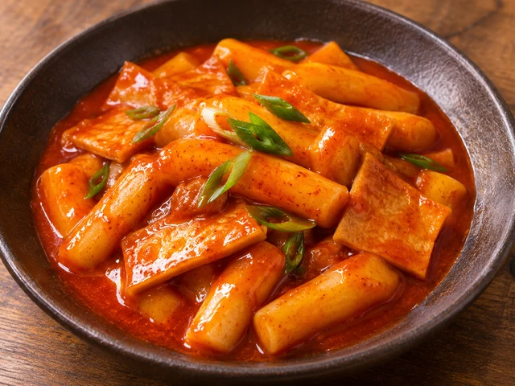
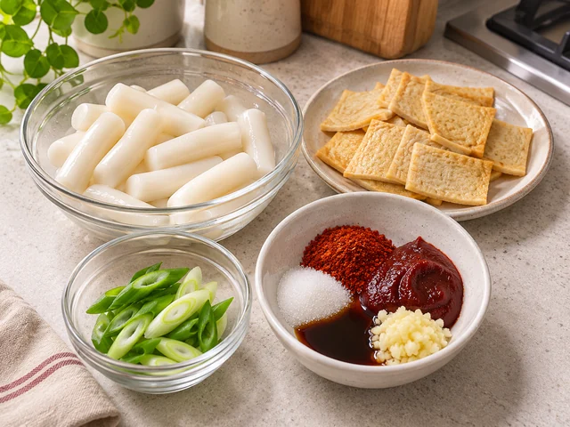
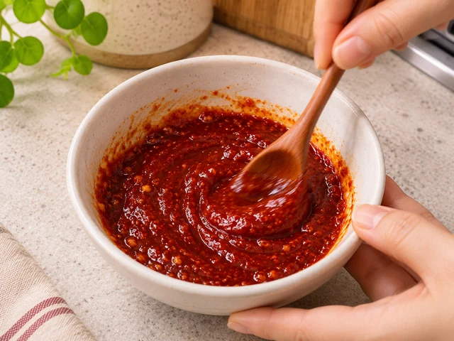
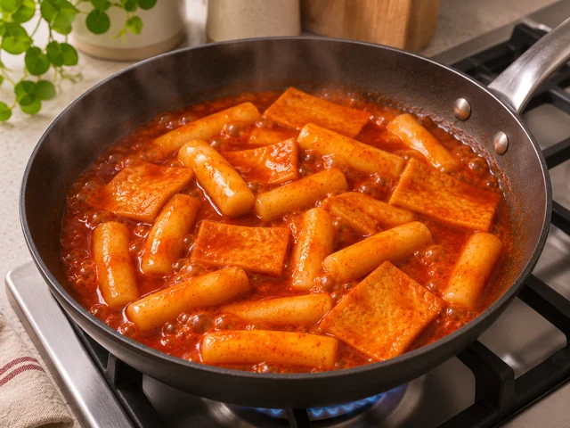

# Classic Tteokbokki

Chewy Korean rice cakes and fish cakes simmered in a sweet-and-spicy gochujang sauce.

- Servings: 2
- Categories: Korean, Snack/Dessert, Late-night snack

## Ingredients

- Korean cylindrical rice cakes (tteokbokki tteok) — 300 g
- Korean fish cake sheets (eomuk) — 120 g
- Green onion — 1/2 stalk
- Water — 500 ml
- Gochujang (Korean chili paste) — 2 tbsp
- Gochugaru (Korean chili flakes) — 1 tbsp
- Sugar — 1 1/2 tbsp
- Korean soy sauce (jin-ganjang) — 1 tbsp
- Minced garlic — 1 tsp

## Instructions

1. Separate the 300 g rice cakes if stuck together. Soak only firm rice cakes in cold water for 10 minutes, then drain. Cut the 120 g fish cake sheets into roughly 3 × 4 cm pieces and slice the 1/2 green onion diagonally.

   

2. In a small bowl, combine 2 tbsp gochujang, 1 tbsp gochugaru, 1 1/2 tbsp sugar, 1 tbsp Korean soy sauce, and 1 tsp minced garlic into a smooth seasoning paste.

   

3. Pour 500 ml water into a wide pan and stir in the seasoning paste. Bring to a simmer over medium-high heat, stirring until completely dissolved, then reduce the heat to medium.

   

4. Add the rice cakes and simmer for 4–5 minutes, stirring occasionally. Add the fish cake pieces and cook for another 3–4 minutes, until the rice cakes are tender and the sauce has thickened slightly.

   

5. Add the diagonally sliced green onion and simmer for 1–2 more minutes, then turn off the heat. Serve warm while a little sauce still remains in the pan.

   

The canonical data for this recipe is [recipe.json](recipe.json).
